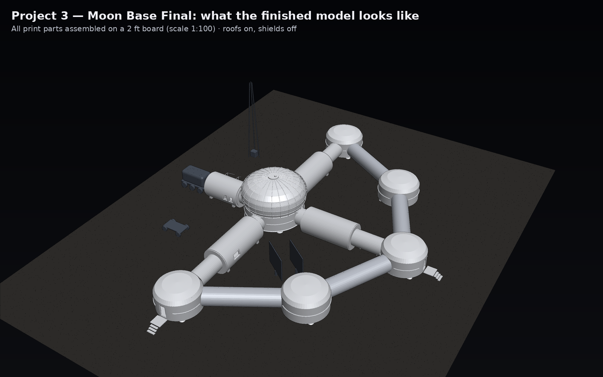
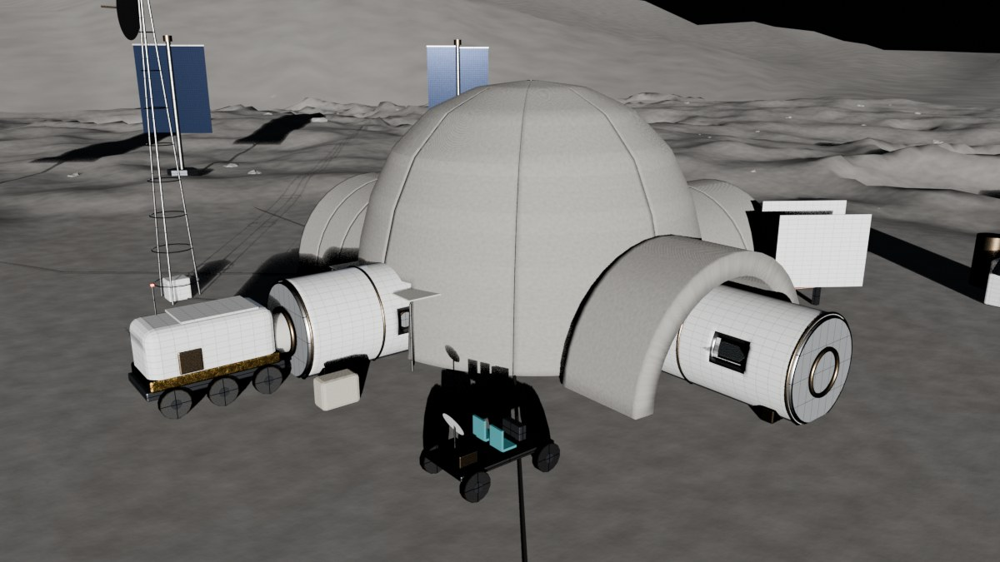
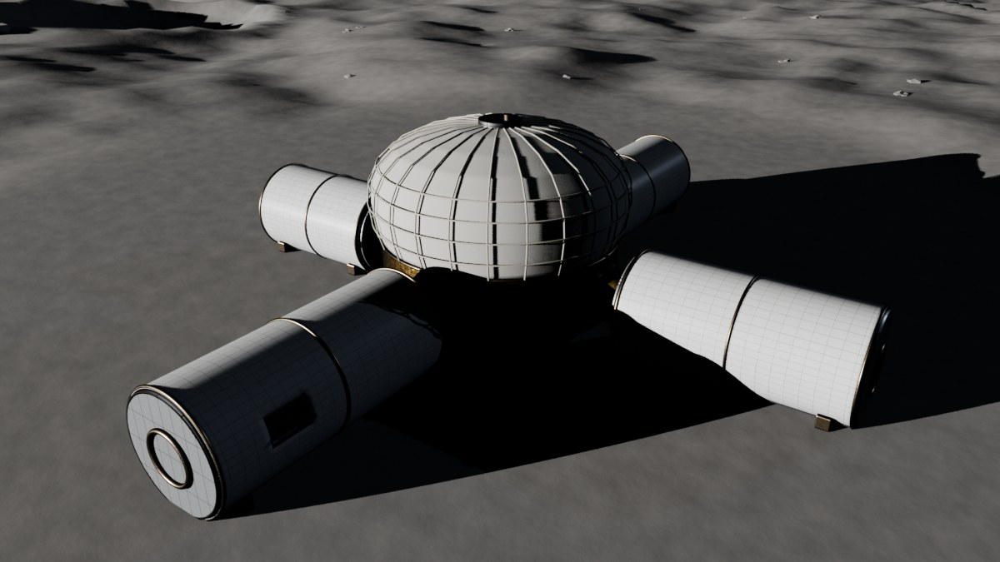
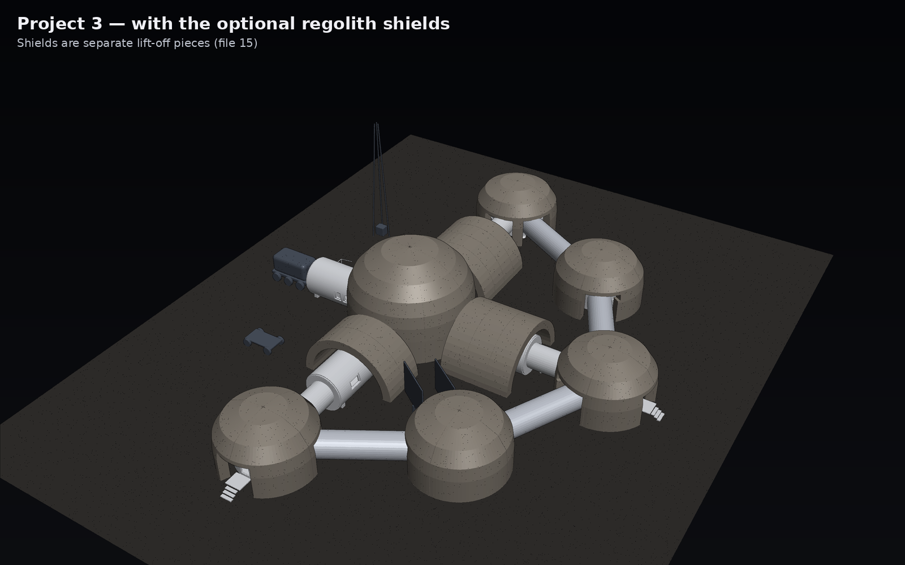
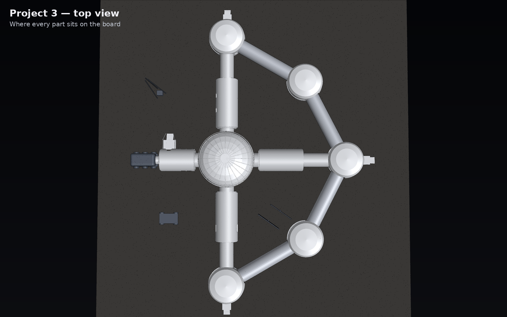
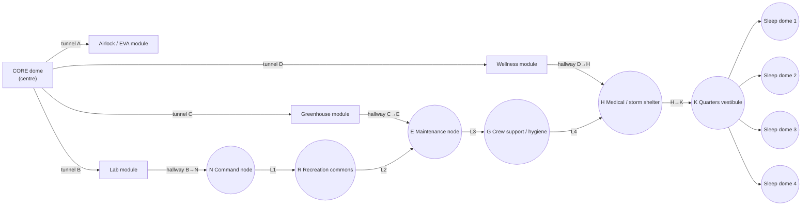

# Build Guide — Project 3 Moon Base (step by step, for anyone)

This guide is for a friend who has **never seen the project** and wants to build the physical model of
**Project 3 — Moon Base Final** (the NASA HUNCH Lunar Smart Adaptive Habitat). Follow the phases in order and tick the boxes.

## What you are building

The real design (Blender render from the VR simulator) looks like this. The print model is a simplified version of it:

| Real design (with regolith shields) | Real design (core + 4 modules) |
|---|---|
|  |  |

With the optional regolith shields on (lift-off pieces):

Top view (this is where every part goes on the board):

---

## How the base is organised (the "system")

The base is made of 5 kinds of parts. Each kind snaps to the next one:

| Kind | Count | Job in the real habitat |
|---|---|---|
| **Core** | 1 | rigid lower deck + inflatable upper deck (crew pods + wardroom) |
| **Modules** | 4 | Airlock/EVA, Lab, Greenhouse, Wellness, one on each side of the core |
| **Nodes** | 6 | Command, Maintenance, Medical + storm shelter, Recreation, Crew support, Quarters vestibule |
| **Sleep domes** | 4 | one private bedroom per astronaut (crew of 4) |
| **Tunnels & hallways** | 16 | connect everything; every file name says what it connects (e.g. `L1_N_to_R`) |
| Exterior extras | 6 | landing pad, cargo lander, 3 solar towers, comms antenna |

**Rule of the system:** every hallway/tunnel end has a **magnet pocket**, so *any* hallway snaps to *any* building. Roofs of the
same size are interchangeable, and each module is two identical halves.

---

## Which kit to use

| Kit folder | Size | Best for |
|---|---|---|
| [`Project3_Moon_Base_Final_unity3/`](Project3_Moon_Base_Final_unity3/) **(recommended)** | 1:150, ≈ 42 × 54 cm | First build. Small parts, about 41 h of printing, about 0.5 kg PLA |
| [`Project3_Big_2ft_Board_1to100/`](Project3_Big_2ft_Board_1to100/) | 1:100, fills a 2 ft board | Presentation model with room interiors, removable roofs, regolith shields, rover. Parts keep their real positions in the slicer |
| [`archive/Project3_kit_v1_earlier/`](archive/Project3_kit_v1_earlier/) | 1:150 | Older version, kept for reference only |

Projects 1 and 2 and the display extras are in their own folders. They follow the same system (see the main [README](README.md)).

---

## Phase 0: Gather supplies (1 day)

- [ ] 3D printer with a bed of at least **210 × 210 mm** (or the school / library makerspace)
- [ ] About **0.6 kg PLA**: white or light grey for the hulls, plus a little dark grey for extras
- [ ] **2 ft × 2 ft board** (foam board, MDF or plywood)
- [ ] **6 × 3 mm neodymium disc magnets**, a pack of 100
- [ ] Super glue (CA), museum putty / Blu-Tack, 220-grit sandpaper, craft knife, tweezers
- [ ] Optional: grey primer + acrylic paint (white hulls, regolith grey, gold accents), battery LED tea lights

## Phase 1: Slicer settings (set once)

| Setting | Value |
|---|---|
| Material | PLA (or PETG) |
| Layer height | 0.2 mm |
| Walls | 3 |
| Infill | 15 % |
| Supports | **none** (every part is designed to print without them) |
| Orientation | **as the file opens**: domes/bases/roofs flat side down, hallways and tunnels standing on one end, module halves on their flat cut face |

## Phase 2: Print, one plate at a time (open set, ≈ 41 h, ≈ 450 g)

Do the plates in this order. Big buildings go first because they take longest and you can test-fit as you go.

| Plate | Files (from `Project3_Moon_Base_Final_unity3/open/`) | PLA | Time |
|---|---|---|---|
| ☐ 1 | `01_Core_BASE` · `01_Core_ROOF` · module halves ×2 each: `02_Module_Airlock_EVA_HALF`, `03_Module_Lab_HALF`, `04_Module_Greenhouse_HALF`, `05_Module_Wellness_HALF` | 90 g | 8.1 h |
| ☐ 2 | `11_Node_Quarters_Vestibule` BASE + ROOF · `12`–`14_SleepDome_Quarters1–3` BASE + ROOF · `15_SleepDome_Quarters4_BASE` | 100 g | 9.0 h |
| ☐ 3 | `15_SleepDome_Quarters4_ROOF` · nodes `06`–`10` BASE + ROOF (Command, Maintenance, Medical, Recreation, Crew support) | 82 g | 7.5 h |
| ☐ 4 | all 16 tunnels/hallways: `02b`–`05b_Tunnel_A–D`, `16`–`27_Hallway_*` (stand them on end) | 82 g | 7.4 h |
| ☐ 5 | `28_Landing_Pad` (200 mm wide, gets its own plate) | 75 g | 6.8 h |
| ☐ 6 | `29_Cargo_Lander` · `30_Solar_Tower` ×3 · `31_Comms_Antenna` | 23 g | 2.0 h |

**Test fit after plate 1:** put the core ROOF on the core BASE. If it is too tight, sand the lip lightly. If it is way off, change
`CLEAR` in `tools/kitlib.py` and regenerate (see the README).

For the faster closed version, print the files in `closed/` instead (37 pieces, ≈ 500 g, ≈ 45 h).

## Phase 3: Clean up and paint (1 evening)

1. Remove any stringing and lightly sand seams with 220 grit.
2. Optional: prime grey, paint the hulls white/silver and the bases regolith grey, and add gold strips (MLI insulation look).
3. Label the inside of every base with a pencil letter (N, E, H, R, G, K, SQ1–SQ4) so you can't mix them up.

## Phase 4: Magnets (30 min + glue drying)

1. Pick a polarity and mark the "outward" side of every magnet with a marker dot.
2. Glue **one magnet into each end pocket** of every tunnel and hallway (dot facing out).
3. Glue one magnet on each building wall where a hallway meets it (dot facing **in**, so it attracts).
4. Let the glue cure for 1 hour. Keep loose magnets apart; they jump together.

## Phase 5: Lay out the board (20 min)

1. Print `Project3_Moon_Base_Final_unity3/00_LAYOUT_GUIDE_print_at_100_percent.svg` at **100 %** (a print shop can do it as one sheet) and tape it to the board.
2. Use the **top view** picture above to double-check orientation: core in the centre, quarters wing toward the bottom-right.

## Phase 6: Assemble (30 min)

Work from the centre outward:

1. ☐ **Core** in the centre circle.
2. ☐ **Tunnels A–D**, then the **modules**: A airlock east, B lab north, C greenhouse west, D wellness south.
3. ☐ **Nodes** on their circles: N, R, E, G, H, then K.
4. ☐ **Hallways**: B→N, C→E, D→H, then the ring L1 N→R, L2 R→E, L3 E→G, L4 G→H, then H→K.
5. ☐ **Sleep domes** SQ1–SQ4 around K, and their 4 short hallways.
6. ☐ **Exterior**: landing pad at the board edge with the cargo lander on it, solar towers around the base, comms antenna next to Command.
7. ☐ Fix bases to the board with putty (removable) or glue (permanent). **Never glue roofs.**

## Phase 7: Optional interior and electronics

- Open set: put furniture, LED tea lights or labels inside the bases before the roofs go on.
- The 2 ft board kit has an electronics list (ESP32, LED strips for each crew pod, CO2/temperature sensors, a pulse sensor
  for the wearable mock-up) in [`Project3_Big_2ft_Board_1to100/README_Print_and_Assembly.md`](Project3_Big_2ft_Board_1to100/README_Print_and_Assembly.md).
  It lets the model show the AI psychological-monitoring system.

## Final check (quality control)

- [ ] All **52 printed pieces** of the open set are used (closed set: 37): 1 core + 4 modules + 6 nodes + 4 sleep domes + 16 tunnels/hallways + 6 exterior extras
- [ ] Every roof lifts off and drops back on without force
- [ ] Every hallway snaps on at both ends (no repelling magnets)
- [ ] The model matches the **finished model** picture at the top of this guide

## Troubleshooting

| Problem | Fix |
|---|---|
| Roof too tight / loose | Sand the lip, or change `CLEAR` in `tools/kitlib.py` and regenerate |
| A hallway repels a building | That magnet is upside down: pop it out with a knife and flip it |
| Part too big for your printer | Scale it to 90 % in the slicer, and scale its matching roof/base by the same amount |
| Long hallway falls over while printing | Add a brim (5 mm) or print it lying down with "supports: touching buildplate" |

---

Made for NASA HUNCH, Project ARES · **Jaineil R.** · with credit to Angel C. and Farhan K.
