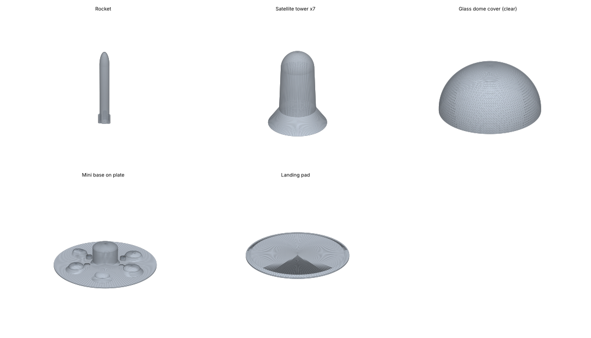

# Display extras (project 1 & 2 world) — 1:700

Scale **1:700** · millimetres · every file is watertight and prints **without supports** · PLA estimates use 0.2 mm layers, 3 walls, 15 % infill.

## DISPLAY set
Total ≈ **256 g** of PLA (≈ 0.26 kg) · ≈ **23 h** of printing

| ✓ | File | Qty | Size L×W×H (mm) | PLA ≈ g | Time ≈ h | What it is | Where it goes |
|---|---|---|---|---|---|---|---|
| ☐ | `01_Rocket.stl` | 1 | 12 × 12 × 102 | 6 | 0.5 | Spaceport rocket (72 m tall real) | spaceport (north-east) |
| ☐ | `02_Landing_Pad.stl` | 1 | 63 × 63 × 2 | 6 | 0.5 | Spaceport landing pad | under the rocket |
| ☐ | `03_Satellite_Tower_print_x7.stl` | 7 | 27 × 27 × 46 | 38 | 3.5 | Satellite 'keep' tower — 7 identical | ring around the kingdom |
| ☐ | `04_Kingdom_Glass_Dome_COVER.stl` | 1 | 197 × 197 × 122 | 118 | 10.7 | Kingdom glass dome (138 m wide real) — print in CLEAR PETG/PLA, place over the mini base | over the mini base |
| ☐ | `05_Mini_Project1_Base_on_plate.stl` | 1 | 149 × 149 × 43 | 88 | 8.0 | The whole project-1 base as one small piece on a plate (sits under the glass dome) | centre of the display |
