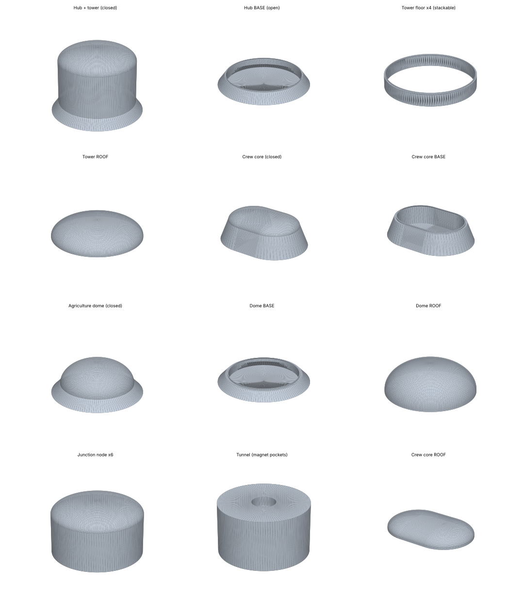

# Project 1 — HUNCH Lunar Base (unity1)

Scale **1:150** · millimetres · every file is watertight and prints **without supports** · PLA estimates use 0.2 mm layers, 3 walls, 15 % infill.

**Where every part goes:** print `00_LAYOUT_GUIDE_print_at_100_percent.svg` at 100 % and lay it on the board.

## CLOSED set — sealed parts (quickest)
Total ≈ **1932 g** of PLA (≈ 1.93 kg) · ≈ **175 h** of printing

| ✓ | File | Qty | Size L×W×H (mm) | PLA ≈ g | Time ≈ h | What it is | Where it goes |
|---|---|---|---|---|---|---|---|
| ☐ | `01_Hub_Tower.stl` | 1 | 199 × 199 × 195 | 960 | 87.3 | Central hub + 5-floor tower (one solid piece) | centre of the board |
| ☐ | `02_Crew_Core.stl` | 1 | 123 × 90 × 53 | 102 | 9.2 | Crew habitat core (pill shape, two decks) | west of the hub |
| ☐ | `03_Agriculture_Dome.stl` | 1 | 142 × 142 × 65 | 160 | 14.5 | Agriculture dome with regolith berm | north-west |
| ☐ | `04_Utility_Dome.stl` | 1 | 141 × 141 × 50 | 136 | 12.4 | Utility dome with regolith berm | north-east |
| ☐ | `05_Medical_Dome.stl` | 1 | 141 × 141 × 56 | 135 | 12.2 | Medical dome with regolith berm | south-west |
| ☐ | `06_Science_Dome.stl` | 1 | 141 × 141 × 56 | 135 | 12.2 | Science dome with regolith berm | south-east |
| ☐ | `07_Logistics_Dome.stl` | 1 | 157 × 157 × 59 | 180 | 16.4 | Logistics dome with regolith berm | east of the hub |
| ☐ | `08_Junction_Node_print_x6.stl` | 6 | 40 × 40 × 31 | 82 | 7.2 | Junction node — 6 identical, any one fits any spot | the 6 small circles around the hub |
| ☐ | `09_Tunnel_Hub_to_N1.stl` | 1 | 24 × 24 × 18 | 4 | 0.4 | tunnel hub → node N1 (2.7 m real) — print standing on one end; magnet pocket in each end | tunnel hub → node N1 |
| ☐ | `10_Tunnel_Hub_to_N2.stl` | 1 | 24 × 24 × 18 | 4 | 0.4 | tunnel hub → node N2 (2.7 m real) — print standing on one end; magnet pocket in each end | tunnel hub → node N2 |
| ☐ | `11_Tunnel_Hub_to_N3.stl` | 1 | 24 × 24 × 18 | 4 | 0.4 | tunnel hub → node N3 (2.7 m real) — print standing on one end; magnet pocket in each end | tunnel hub → node N3 |
| ☐ | `12_Tunnel_Hub_to_N4.stl` | 1 | 24 × 24 × 18 | 4 | 0.4 | tunnel hub → node N4 (2.7 m real) — print standing on one end; magnet pocket in each end | tunnel hub → node N4 |
| ☐ | `13_Tunnel_Hub_to_N5.stl` | 1 | 24 × 24 × 18 | 4 | 0.4 | tunnel hub → node N5 (2.7 m real) — print standing on one end; magnet pocket in each end | tunnel hub → node N5 |
| ☐ | `14_Tunnel_Hub_to_N6.stl` | 1 | 24 × 24 × 18 | 4 | 0.4 | tunnel hub → node N6 (2.7 m real) — print standing on one end; magnet pocket in each end | tunnel hub → node N6 |
| ☐ | `15_Tunnel_N3_to_Agriculture.stl` | 1 | 24 × 24 × 8 | 3 | 0.2 | tunnel node N3 → Agriculture (-1.2 m real) — print standing on one end; magnet pocket in each end | tunnel node N3 → Agriculture |
| ☐ | `16_Tunnel_N2_to_Utility.stl` | 1 | 24 × 24 × 7 | 2 | 0.2 | tunnel node N2 → Utility (-1.1 m real) — print standing on one end; magnet pocket in each end | tunnel node N2 → Utility |
| ☐ | `17_Tunnel_N5_to_Medical.stl` | 1 | 24 × 24 × 7 | 2 | 0.2 | tunnel node N5 → Medical (-1.1 m real) — print standing on one end; magnet pocket in each end | tunnel node N5 → Medical |
| ☐ | `18_Tunnel_N6_to_Science.stl` | 1 | 24 × 24 × 7 | 2 | 0.2 | tunnel node N6 → Science (-1.1 m real) — print standing on one end; magnet pocket in each end | tunnel node N6 → Science |
| ☐ | `19_Tunnel_N1_to_Logistics.stl` | 1 | 24 × 24 × 15 | 4 | 0.3 | tunnel node N1 → Logistics (-2.3 m real) — print standing on one end; magnet pocket in each end | tunnel node N1 → Logistics |
| ☐ | `20_Tunnel_N4_to_CrewCore.stl` | 1 | 24 × 24 × 12 | 3 | 0.3 | tunnel node N4 → crew core (1.8 m real) — print standing on one end; magnet pocket in each end | tunnel node N4 → crew core |

## OPEN set — lift-off roofs & stackable floors (build inside)
Total ≈ **1063 g** of PLA (≈ 1.06 kg) · ≈ **97 h** of printing

| ✓ | File | Qty | Size L×W×H (mm) | PLA ≈ g | Time ≈ h | What it is | Where it goes |
|---|---|---|---|---|---|---|---|
| ☐ | `01a_Hub_BASE_ground_floor.stl` | 1 | 199 × 199 × 31 | 149 | 13.6 | Hub ground floor with regolith berm — the tower floors stack on its lip | centre of the board |
| ☐ | `01b_Hub_TOWER_FLOOR_print_x4.stl` | 4 | 168 × 168 × 33 | 141 | 12.8 | Tower floor (mezzanine / command / emergency medical / ICU) — 4 IDENTICAL rings: stack them in any order | on top of the hub base |
| ☐ | `01c_Hub_ROOF.stl` | 1 | 168 × 168 × 43 | 52 | 4.8 | Tower dome roof — sits on the top floor | top of the tower |
| ☐ | `02a_Crew_Core_BASE.stl` | 1 | 123 × 90 × 37 | 64 | 5.8 | Crew core — hollow base with lip | west of the hub |
| ☐ | `02b_Crew_Core_ROOF.stl` | 1 | 101 × 68 × 19 | 14 | 1.3 | Crew core — lift-off roof | west of the hub |
| ☐ | `03_Agriculture_Dome_BASE.stl` | 1 | 142 × 142 × 19 | 68 | 6.2 | Agriculture dome — hollow base with lip | north-west |
| ☐ | `03_Agriculture_Dome_ROOF.stl` | 1 | 114 × 114 × 49 | 32 | 2.9 | Agriculture dome — lift-off roof | north-west |
| ☐ | `04_Utility_Dome_BASE.stl` | 1 | 141 × 141 × 24 | 75 | 6.8 | Utility dome — hollow base with lip | north-east |
| ☐ | `04_Utility_Dome_ROOF.stl` | 1 | 109 × 109 × 28 | 22 | 2.0 | Utility dome — lift-off roof | north-east |
| ☐ | `05_Medical_Dome_BASE.stl` | 1 | 141 × 141 × 24 | 76 | 6.9 | Medical dome — hollow base with lip | south-west |
| ☐ | `05_Medical_Dome_ROOF.stl` | 1 | 101 × 101 × 35 | 22 | 2.0 | Medical dome — lift-off roof | south-west |
| ☐ | `06_Science_Dome_BASE.stl` | 1 | 141 × 141 × 24 | 76 | 6.9 | Science dome — hollow base with lip | south-east |
| ☐ | `06_Science_Dome_ROOF.stl` | 1 | 101 × 101 × 35 | 22 | 2.0 | Science dome — lift-off roof | south-east |
| ☐ | `07_Logistics_Dome_BASE.stl` | 1 | 157 × 157 × 29 | 102 | 9.3 | Logistics dome — hollow base with lip | east of the hub |
| ☐ | `07_Logistics_Dome_ROOF.stl` | 1 | 114 × 114 × 32 | 25 | 2.3 | Logistics dome — lift-off roof | east of the hub |
| ☐ | `08_Junction_Node_BASE_print_x6.stl` | 6 | 40 × 40 × 23 | 62 | 5.4 | Junction node — hollow base | the 6 small circles around the hub |
| ☐ | `08_Junction_Node_ROOF_print_x6.stl` | 6 | 40 × 40 × 11 | 17 | 1.8 | Junction node — roof | on each node base |
| ☐ | `09_Tunnel_Hub_to_N1.stl` | 1 | 24 × 24 × 18 | 4 | 0.4 | tunnel hub → node N1 (2.7 m real) — print standing on one end; magnet pocket in each end | tunnel hub → node N1 |
| ☐ | `10_Tunnel_Hub_to_N2.stl` | 1 | 24 × 24 × 18 | 4 | 0.4 | tunnel hub → node N2 (2.7 m real) — print standing on one end; magnet pocket in each end | tunnel hub → node N2 |
| ☐ | `11_Tunnel_Hub_to_N3.stl` | 1 | 24 × 24 × 18 | 4 | 0.4 | tunnel hub → node N3 (2.7 m real) — print standing on one end; magnet pocket in each end | tunnel hub → node N3 |
| ☐ | `12_Tunnel_Hub_to_N4.stl` | 1 | 24 × 24 × 18 | 4 | 0.4 | tunnel hub → node N4 (2.7 m real) — print standing on one end; magnet pocket in each end | tunnel hub → node N4 |
| ☐ | `13_Tunnel_Hub_to_N5.stl` | 1 | 24 × 24 × 18 | 4 | 0.4 | tunnel hub → node N5 (2.7 m real) — print standing on one end; magnet pocket in each end | tunnel hub → node N5 |
| ☐ | `14_Tunnel_Hub_to_N6.stl` | 1 | 24 × 24 × 18 | 4 | 0.4 | tunnel hub → node N6 (2.7 m real) — print standing on one end; magnet pocket in each end | tunnel hub → node N6 |
| ☐ | `15_Tunnel_N3_to_Agriculture.stl` | 1 | 24 × 24 × 8 | 3 | 0.2 | tunnel node N3 → Agriculture (-1.2 m real) — print standing on one end; magnet pocket in each end | tunnel node N3 → Agriculture |
| ☐ | `16_Tunnel_N2_to_Utility.stl` | 1 | 24 × 24 × 7 | 2 | 0.2 | tunnel node N2 → Utility (-1.1 m real) — print standing on one end; magnet pocket in each end | tunnel node N2 → Utility |
| ☐ | `17_Tunnel_N5_to_Medical.stl` | 1 | 24 × 24 × 7 | 2 | 0.2 | tunnel node N5 → Medical (-1.1 m real) — print standing on one end; magnet pocket in each end | tunnel node N5 → Medical |
| ☐ | `18_Tunnel_N6_to_Science.stl` | 1 | 24 × 24 × 7 | 2 | 0.2 | tunnel node N6 → Science (-1.1 m real) — print standing on one end; magnet pocket in each end | tunnel node N6 → Science |
| ☐ | `19_Tunnel_N1_to_Logistics.stl` | 1 | 24 × 24 × 15 | 4 | 0.3 | tunnel node N1 → Logistics (-2.3 m real) — print standing on one end; magnet pocket in each end | tunnel node N1 → Logistics |
| ☐ | `20_Tunnel_N4_to_CrewCore.stl` | 1 | 24 × 24 × 12 | 3 | 0.3 | tunnel node N4 → crew core (1.8 m real) — print standing on one end; magnet pocket in each end | tunnel node N4 → crew core |
