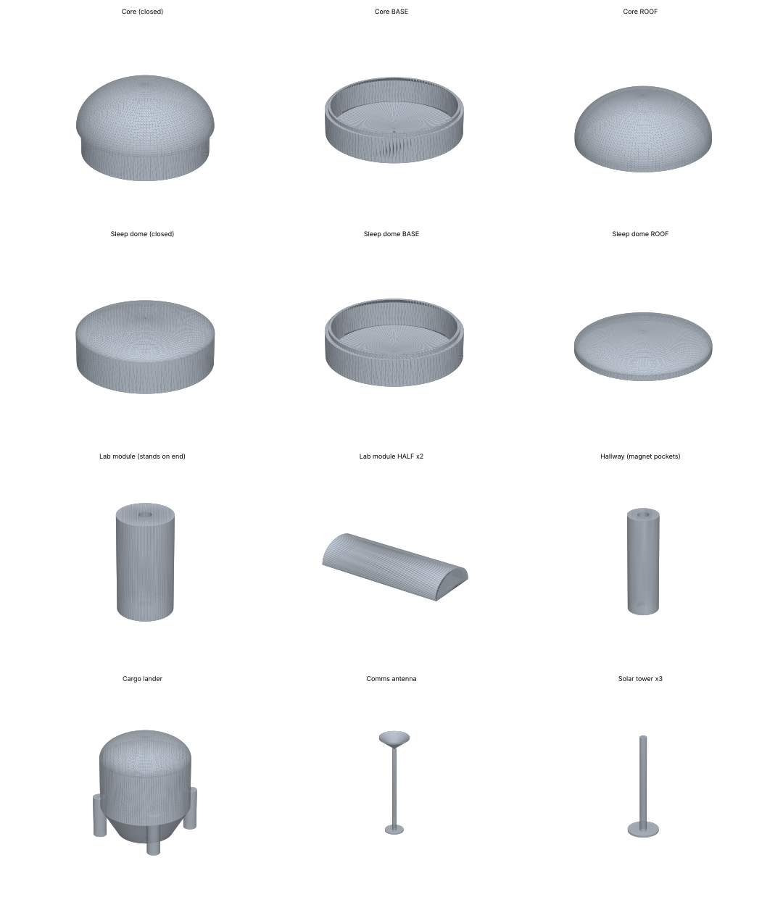

# Project 3 — Lunar Smart Adaptive Habitat (VR simulator)

Scale **1:150** · millimetres · every file is watertight and prints **without supports** · PLA estimates use 0.2 mm layers, 3 walls, 15 % infill.

**Where every part goes:** print `00_LAYOUT_GUIDE_print_at_100_percent.svg` at 100 % and lay it on the board.

## CLOSED set — sealed parts (quickest)
Total ≈ **500 g** of PLA (≈ 0.50 kg) · ≈ **45 h** of printing

| ✓ | File | Qty | Size L×W×H (mm) | PLA ≈ g | Time ≈ h | What it is | Where it goes |
|---|---|---|---|---|---|---|---|
| ☐ | `01_Core.stl` | 1 | 73 × 73 × 52 | 50 | 4.5 | Core habitat (rigid lower deck + inflatable upper deck) | centre |
| ☐ | `02_Module_Airlock_EVA.stl` | 1 | 28 × 28 × 47 | 12 | 1.1 | Module Airlock EVA — stands on one end to print | east of the core |
| ☐ | `02b_Tunnel_A.stl` | 1 | 18 × 18 × 18 | 3 | 0.2 | short tunnel core ↔ airlock_eva | between core and airlock_eva |
| ☐ | `03_Module_Lab.stl` | 1 | 28 × 28 × 67 | 16 | 1.5 | Module Lab — stands on one end to print | north of the core |
| ☐ | `03b_Tunnel_B.stl` | 1 | 18 × 18 × 18 | 3 | 0.2 | short tunnel core ↔ lab | between core and lab |
| ☐ | `04_Module_Greenhouse.stl` | 1 | 28 × 28 × 60 | 15 | 1.4 | Module Greenhouse — stands on one end to print | west of the core |
| ☐ | `04b_Tunnel_C.stl` | 1 | 18 × 18 × 18 | 3 | 0.2 | short tunnel core ↔ greenhouse | between core and greenhouse |
| ☐ | `05_Module_Wellness.stl` | 1 | 28 × 28 × 67 | 16 | 1.5 | Module Wellness — stands on one end to print | south of the core |
| ☐ | `05b_Tunnel_D.stl` | 1 | 18 × 18 × 18 | 3 | 0.2 | short tunnel core ↔ wellness | between core and wellness |
| ☐ | `06_Node_Command.stl` | 1 | 48 × 48 × 27 | 17 | 1.5 | Node Command | circle N on the guide |
| ☐ | `07_Node_Maintenance.stl` | 1 | 48 × 48 × 27 | 17 | 1.5 | Node Maintenance | circle E on the guide |
| ☐ | `08_Node_Medical_StormShelter.stl` | 1 | 48 × 48 × 27 | 17 | 1.5 | Node Medical StormShelter | circle H on the guide |
| ☐ | `09_Node_Recreation_Commons.stl` | 1 | 48 × 48 × 27 | 17 | 1.5 | Node Recreation Commons | circle R on the guide |
| ☐ | `10_Node_CrewSupport_Hygiene2.stl` | 1 | 48 × 48 × 27 | 17 | 1.5 | Node CrewSupport Hygiene2 | circle G on the guide |
| ☐ | `11_Node_Quarters_Vestibule.stl` | 1 | 60 × 60 × 27 | 25 | 2.3 | Node Quarters Vestibule | circle K on the guide |
| ☐ | `12_SleepDome_Quarters1.stl` | 1 | 60 × 60 × 27 | 25 | 2.3 | SleepDome Quarters1 | circle SQ1 on the guide |
| ☐ | `13_SleepDome_Quarters2.stl` | 1 | 60 × 60 × 27 | 25 | 2.3 | SleepDome Quarters2 | circle SQ2 on the guide |
| ☐ | `14_SleepDome_Quarters3.stl` | 1 | 60 × 60 × 27 | 25 | 2.3 | SleepDome Quarters3 | circle SQ3 on the guide |
| ☐ | `15_SleepDome_Quarters4.stl` | 1 | 60 × 60 × 27 | 25 | 2.3 | SleepDome Quarters4 | circle SQ4 on the guide |
| ☐ | `16_Hallway_N01_B_to_N.stl` | 1 | 18 × 18 × 34 | 5 | 0.4 | hallway B → N (5.1 m real) — print standing on one end; magnet pocket in each end | hallway B → N |
| ☐ | `17_Hallway_H01_D_to_H.stl` | 1 | 18 × 18 × 34 | 5 | 0.4 | hallway D → H (5.1 m real) — print standing on one end; magnet pocket in each end | hallway D → H |
| ☐ | `18_Hallway_E01_C_to_E.stl` | 1 | 18 × 18 × 34 | 5 | 0.4 | hallway C → E (5.1 m real) — print standing on one end; magnet pocket in each end | hallway C → E |
| ☐ | `19_Hallway_L1_N_to_R.stl` | 1 | 18 × 18 × 76 | 9 | 0.9 | hallway N → R (11.5 m real) — print standing on one end; magnet pocket in each end | hallway N → R |
| ☐ | `20_Hallway_L2_R_to_E.stl` | 1 | 18 × 18 × 73 | 9 | 0.8 | hallway R → E (11.0 m real) — print standing on one end; magnet pocket in each end | hallway R → E |
| ☐ | `21_Hallway_L3_E_to_G.stl` | 1 | 18 × 18 × 73 | 9 | 0.8 | hallway E → G (11.0 m real) — print standing on one end; magnet pocket in each end | hallway E → G |
| ☐ | `22_Hallway_L4_G_to_H.stl` | 1 | 18 × 18 × 76 | 9 | 0.9 | hallway G → H (11.5 m real) — print standing on one end; magnet pocket in each end | hallway G → H |
| ☐ | `23_Hallway_K_H_to_K.stl` | 1 | 18 × 18 × 32 | 4 | 0.4 | hallway H → K (4.8 m real) — print standing on one end; magnet pocket in each end | hallway H → K |
| ☐ | `24_Hallway_SQ1_K_to_SQ1.stl` | 1 | 18 × 18 × 28 | 4 | 0.4 | hallway K → SQ1 (4.3 m real) — print standing on one end; magnet pocket in each end | hallway K → SQ1 |
| ☐ | `25_Hallway_SQ2_K_to_SQ2.stl` | 1 | 18 × 18 × 28 | 4 | 0.4 | hallway K → SQ2 (4.3 m real) — print standing on one end; magnet pocket in each end | hallway K → SQ2 |
| ☐ | `26_Hallway_SQ3_K_to_SQ3.stl` | 1 | 18 × 18 × 28 | 4 | 0.4 | hallway K → SQ3 (4.3 m real) — print standing on one end; magnet pocket in each end | hallway K → SQ3 |
| ☐ | `27_Hallway_SQ4_K_to_SQ4.stl` | 1 | 18 × 18 × 28 | 4 | 0.4 | hallway K → SQ4 (4.3 m real) — print standing on one end; magnet pocket in each end | hallway K → SQ4 |
| ☐ | `28_Landing_Pad.stl` | 1 | 200 × 200 × 2 | 75 | 6.8 | Cargo landing pad (30 m wide, sintered regolith) | 300 m away in real life — put it at the board edge |
| ☐ | `29_Cargo_Lander.stl` | 1 | 28 × 28 × 43 | 10 | 1.0 | Cargo lander (body on 4 legs) | on the landing pad |
| ☐ | `30_Solar_Tower_print_x3.stl` | 3 | 21 × 21 × 93 | 8 | 0.6 | Solar-tower mast on a foot (glue a 10 × 4 mm card 'panel' on top) | around the base |
| ☐ | `31_Comms_Antenna.stl` | 1 | 29 × 29 × 137 | 4 | 0.4 | Comms mast with dish | next to the command node |

## OPEN set — lift-off roofs & stackable floors (build inside)
Total ≈ **451 g** of PLA (≈ 0.45 kg) · ≈ **41 h** of printing

| ✓ | File | Qty | Size L×W×H (mm) | PLA ≈ g | Time ≈ h | What it is | Where it goes |
|---|---|---|---|---|---|---|---|
| ☐ | `01_Core_BASE.stl` | 1 | 68 × 68 × 19 | 19 | 1.7 | Core lower deck — hollow base with lip | centre |
| ☐ | `01_Core_ROOF.stl` | 1 | 73 × 73 × 34 | 24 | 2.2 | Core inflatable upper deck — lift-off roof | centre |
| ☐ | `02_Module_Airlock_EVA_HALF_print_x2.stl` | 2 | 47 × 28 × 14 | 9 | 0.8 | Module Airlock EVA — hollow half; print 2 (one is the lid) | east of the core |
| ☐ | `02b_Tunnel_A.stl` | 1 | 18 × 18 × 18 | 3 | 0.2 | short tunnel core ↔ airlock_eva | between core and airlock_eva |
| ☐ | `03_Module_Lab_HALF_print_x2.stl` | 2 | 67 × 28 × 14 | 13 | 1.2 | Module Lab — hollow half; print 2 (one is the lid) | north of the core |
| ☐ | `03b_Tunnel_B.stl` | 1 | 18 × 18 × 18 | 3 | 0.2 | short tunnel core ↔ lab | between core and lab |
| ☐ | `04_Module_Greenhouse_HALF_print_x2.stl` | 2 | 60 × 28 × 14 | 12 | 1.0 | Module Greenhouse — hollow half; print 2 (one is the lid) | west of the core |
| ☐ | `04b_Tunnel_C.stl` | 1 | 18 × 18 × 18 | 3 | 0.2 | short tunnel core ↔ greenhouse | between core and greenhouse |
| ☐ | `05_Module_Wellness_HALF_print_x2.stl` | 2 | 67 × 28 × 14 | 13 | 1.2 | Module Wellness — hollow half; print 2 (one is the lid) | south of the core |
| ☐ | `05b_Tunnel_D.stl` | 1 | 18 × 18 × 18 | 3 | 0.2 | short tunnel core ↔ wellness | between core and wellness |
| ☐ | `06_Node_Command_BASE.stl` | 1 | 48 × 48 × 18 | 11 | 1.0 | Node Command — hollow base with lip | circle N on the guide |
| ☐ | `06_Node_Command_ROOF.stl` | 1 | 48 × 48 × 11 | 4 | 0.4 | Node Command — lift-off roof | on base N |
| ☐ | `07_Node_Maintenance_BASE.stl` | 1 | 48 × 48 × 18 | 11 | 1.0 | Node Maintenance — hollow base with lip | circle E on the guide |
| ☐ | `07_Node_Maintenance_ROOF.stl` | 1 | 48 × 48 × 11 | 4 | 0.4 | Node Maintenance — lift-off roof | on base E |
| ☐ | `08_Node_Medical_StormShelter_BASE.stl` | 1 | 48 × 48 × 18 | 11 | 1.0 | Node Medical StormShelter — hollow base with lip | circle H on the guide |
| ☐ | `08_Node_Medical_StormShelter_ROOF.stl` | 1 | 48 × 48 × 11 | 4 | 0.4 | Node Medical StormShelter — lift-off roof | on base H |
| ☐ | `09_Node_Recreation_Commons_BASE.stl` | 1 | 48 × 48 × 18 | 11 | 1.0 | Node Recreation Commons — hollow base with lip | circle R on the guide |
| ☐ | `09_Node_Recreation_Commons_ROOF.stl` | 1 | 48 × 48 × 11 | 4 | 0.4 | Node Recreation Commons — lift-off roof | on base R |
| ☐ | `10_Node_CrewSupport_Hygiene2_BASE.stl` | 1 | 48 × 48 × 18 | 11 | 1.0 | Node CrewSupport Hygiene2 — hollow base with lip | circle G on the guide |
| ☐ | `10_Node_CrewSupport_Hygiene2_ROOF.stl` | 1 | 48 × 48 × 11 | 4 | 0.4 | Node CrewSupport Hygiene2 — lift-off roof | on base G |
| ☐ | `11_Node_Quarters_Vestibule_BASE.stl` | 1 | 60 × 60 × 18 | 15 | 1.4 | Node Quarters Vestibule — hollow base with lip | circle K on the guide |
| ☐ | `11_Node_Quarters_Vestibule_ROOF.stl` | 1 | 60 × 60 × 11 | 6 | 0.5 | Node Quarters Vestibule — lift-off roof | on base K |
| ☐ | `12_SleepDome_Quarters1_BASE.stl` | 1 | 60 × 60 × 18 | 15 | 1.4 | SleepDome Quarters1 — hollow base with lip | circle SQ1 on the guide |
| ☐ | `12_SleepDome_Quarters1_ROOF.stl` | 1 | 60 × 60 × 11 | 6 | 0.5 | SleepDome Quarters1 — lift-off roof | on base SQ1 |
| ☐ | `13_SleepDome_Quarters2_BASE.stl` | 1 | 60 × 60 × 18 | 15 | 1.4 | SleepDome Quarters2 — hollow base with lip | circle SQ2 on the guide |
| ☐ | `13_SleepDome_Quarters2_ROOF.stl` | 1 | 60 × 60 × 11 | 6 | 0.5 | SleepDome Quarters2 — lift-off roof | on base SQ2 |
| ☐ | `14_SleepDome_Quarters3_BASE.stl` | 1 | 60 × 60 × 18 | 15 | 1.4 | SleepDome Quarters3 — hollow base with lip | circle SQ3 on the guide |
| ☐ | `14_SleepDome_Quarters3_ROOF.stl` | 1 | 60 × 60 × 11 | 6 | 0.5 | SleepDome Quarters3 — lift-off roof | on base SQ3 |
| ☐ | `15_SleepDome_Quarters4_BASE.stl` | 1 | 60 × 60 × 18 | 15 | 1.4 | SleepDome Quarters4 — hollow base with lip | circle SQ4 on the guide |
| ☐ | `15_SleepDome_Quarters4_ROOF.stl` | 1 | 60 × 60 × 11 | 6 | 0.5 | SleepDome Quarters4 — lift-off roof | on base SQ4 |
| ☐ | `16_Hallway_N01_B_to_N.stl` | 1 | 18 × 18 × 34 | 5 | 0.4 | hallway B → N (5.1 m real) — print standing on one end; magnet pocket in each end | hallway B → N |
| ☐ | `17_Hallway_H01_D_to_H.stl` | 1 | 18 × 18 × 34 | 5 | 0.4 | hallway D → H (5.1 m real) — print standing on one end; magnet pocket in each end | hallway D → H |
| ☐ | `18_Hallway_E01_C_to_E.stl` | 1 | 18 × 18 × 34 | 5 | 0.4 | hallway C → E (5.1 m real) — print standing on one end; magnet pocket in each end | hallway C → E |
| ☐ | `19_Hallway_L1_N_to_R.stl` | 1 | 18 × 18 × 76 | 9 | 0.9 | hallway N → R (11.5 m real) — print standing on one end; magnet pocket in each end | hallway N → R |
| ☐ | `20_Hallway_L2_R_to_E.stl` | 1 | 18 × 18 × 73 | 9 | 0.8 | hallway R → E (11.0 m real) — print standing on one end; magnet pocket in each end | hallway R → E |
| ☐ | `21_Hallway_L3_E_to_G.stl` | 1 | 18 × 18 × 73 | 9 | 0.8 | hallway E → G (11.0 m real) — print standing on one end; magnet pocket in each end | hallway E → G |
| ☐ | `22_Hallway_L4_G_to_H.stl` | 1 | 18 × 18 × 76 | 9 | 0.9 | hallway G → H (11.5 m real) — print standing on one end; magnet pocket in each end | hallway G → H |
| ☐ | `23_Hallway_K_H_to_K.stl` | 1 | 18 × 18 × 32 | 4 | 0.4 | hallway H → K (4.8 m real) — print standing on one end; magnet pocket in each end | hallway H → K |
| ☐ | `24_Hallway_SQ1_K_to_SQ1.stl` | 1 | 18 × 18 × 28 | 4 | 0.4 | hallway K → SQ1 (4.3 m real) — print standing on one end; magnet pocket in each end | hallway K → SQ1 |
| ☐ | `25_Hallway_SQ2_K_to_SQ2.stl` | 1 | 18 × 18 × 28 | 4 | 0.4 | hallway K → SQ2 (4.3 m real) — print standing on one end; magnet pocket in each end | hallway K → SQ2 |
| ☐ | `26_Hallway_SQ3_K_to_SQ3.stl` | 1 | 18 × 18 × 28 | 4 | 0.4 | hallway K → SQ3 (4.3 m real) — print standing on one end; magnet pocket in each end | hallway K → SQ3 |
| ☐ | `27_Hallway_SQ4_K_to_SQ4.stl` | 1 | 18 × 18 × 28 | 4 | 0.4 | hallway K → SQ4 (4.3 m real) — print standing on one end; magnet pocket in each end | hallway K → SQ4 |
| ☐ | `28_Landing_Pad.stl` | 1 | 200 × 200 × 2 | 75 | 6.8 | Cargo landing pad (30 m wide, sintered regolith) | 300 m away in real life — put it at the board edge |
| ☐ | `29_Cargo_Lander.stl` | 1 | 28 × 28 × 43 | 10 | 1.0 | Cargo lander (body on 4 legs) | on the landing pad |
| ☐ | `30_Solar_Tower_print_x3.stl` | 3 | 21 × 21 × 93 | 8 | 0.6 | Solar-tower mast on a foot (glue a 10 × 4 mm card 'panel' on top) | around the base |
| ☐ | `31_Comms_Antenna.stl` | 1 | 29 × 29 × 137 | 4 | 0.4 | Comms mast with dish | next to the command node |
