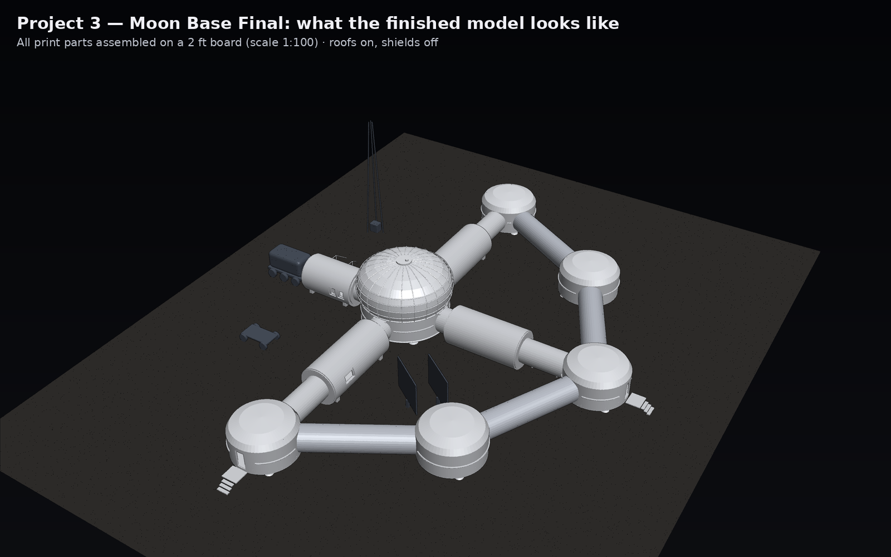

# NASA HUNCH — 3D print kits for all three projects

> **New here? Start with the [step-by-step BUILD GUIDE](BUILD_GUIDE.md)**: pictures of the finished model, the parts system, a print-plate plan and assembly order, written so anyone can build it.

Simple, clean, print-ready STL models of every NASA HUNCH lunar base we built — domes, cylinders and tubes, nothing
fancy. Every file is **watertight** (checked by the generator), in **millimetres**, and prints **without supports**.

| Folder | What | Scale | Fits |
|---|---|---|---|
| [`Project1_HUNCH_Lunar_Base_unity1/`](Project1_HUNCH_Lunar_Base_unity1/) | Project 1 base: central hub + 5-floor tower, crew core, agriculture / utility / medical / science / logistics domes, 6 junction nodes, tunnels | 1:150 | 2 ft board |
| [`Project2_Lunar_Habitat_Commander_unity2/`](Project2_Lunar_Habitat_Commander_unity2/) | Project 2 base (the project 1 design built 1.5× bigger) | 1:225 | 2 ft board |
| [`Project3_Moon_Base_Final_unity3/`](Project3_Moon_Base_Final_unity3/) | Project 3 VR-simulator base: core, 4 modules, 6 nodes, **4 sleep domes**, hallways + landing pad, cargo lander, solar towers, comms mast | 1:150 | 2 ft board |
| [`Project3_Big_2ft_Board_1to100/`](Project3_Big_2ft_Board_1to100/) | Project 3 big presentation model: fills a 2 ft board, removable roofs, room inserts, regolith shields, rover; parts keep real positions + electronics list | 1:100 | 2 ft board |
| [`Extras_Display_1to700/`](Extras_Display_1to700/) | Display pieces from the project 1/2 world: rocket, landing pad, 7 satellite towers, the giant glass "kingdom" dome (print clear) + the whole project 1 base as one mini piece | 1:700 | a shelf |

Each folder has a **README with a full spec sheet** (size, plastic, print time, what it is, where it goes), a
**preview picture**, the **layout guide** (true-scale SVG) and two sets:
- **`closed/`** — sealed pieces. Quickest; good for a display.
- **`open/`** — lift-off roofs, stackable tower floors and hollow module halves, so your group can **build inside**
  (rooms, furniture, LEDs, sensors).

Older Project 3 kit (v1) is kept in [`archive/`](archive/). GitHub shows every `.stl` file as a 3D model you can spin in the browser.

`SPECS_all_parts.csv` has every part of every project in one spreadsheet.

---

## What to print (checklist)

**Minimum for a presentation (pick ONE project, closed set):**
- [ ] Project 3 closed — 37 pieces · ≈ 0.5 kg · ≈ 45 h  ← smallest and matches the VR game
- [ ] Project 1 closed — 25 pieces · ≈ 1.9 kg · ≈ 175 h

**Full build-inside model (open set):**
- [ ] Project 3 open — 52 pieces · ≈ 0.5 kg · ≈ 41 h
- [ ] Project 1 open — 42 pieces · ≈ 1.1 kg · ≈ 97 h
- [ ] Project 2 open — 42 pieces · ≈ 1.1 kg · ≈ 97 h (same parts as project 1, different scale)

**Display extras:** 11 pieces · ≈ 0.3 kg · ≈ 23 h

Print order that saves time: **big domes first** (they take longest), then roofs, then hallways/tunnels (many can share
one print plate), then extras. Tick the ☐ boxes in each project README as you go.

## Where to print
- **Printer bed:** the biggest part is **200 mm** across (project 1 hub base), so you need a bed of **at least 210 × 210 mm**
  (e.g. Ender-3 / Prusa MK4 / Bambu P1S–X1C size). On a smaller printer, scale a part down to 90 % in the slicer — but scale
  its matching roof/base by the same amount.
- **Options:** your own printer · the school engineering / TSA / makerspace printers · a public library makerspace ·
  an online print service (upload the STL, they mail the parts).
- **Settings:** PLA (or PETG), 0.2 mm layers, 3 walls, 10–15 % infill, **no supports**. The glass dome cover looks best in
  **clear PETG/PLA**.
- **Orientation:** print every file as it opens (already placed flat on the bed): domes, bases and roofs flat side down;
  closed modules, tunnels and hallways **standing on one end**; module HALVES on their flat cut face.

## Parts to bring (besides the prints)
- [ ] 2 ft × 2 ft board (foam board, plywood or MDF) + the **layout guide** printed at 100 % (or drawn on the board)
- [ ] **6 × 3 mm neodymium disc magnets** — 2 per hallway/tunnel + 1 per connection point on a building
      (project 3: 16 tubes → ≈ 64 magnets · project 1/2: 12 tunnels → ≈ 48). A pack of 100 covers one full base. Mark the polarity so every tube end matches every building!
- [ ] Super glue (CA) for magnets · museum putty / Blu-Tack to hold buildings on the board without glue
- [ ] Grey or white primer + acrylic paint (regolith grey for berms, white/silver for hulls, gold for MLI accents)
- [ ] Optional: battery LED tea lights or 3 mm LEDs + coin cells to light the inside of the open set; a craft knife;
      fine sandpaper (220 grit); tweezers

## Interchangeable parts system
- **Magnet ports:** every hallway and tunnel has a **6 × 3 mm magnet pocket in each end**. Glue one magnet into each
  pocket and one magnet on each building wall where a hallway meets it (all with the same side facing out). Now **any
  hallway snaps onto any building** — rearrange the base, swap a module, or show Configuration A vs B live.
- **Stackable tower (project 1/2):** the hub tower is **4 identical floor rings** that stack on the hub base in any order,
  with the dome roof on top. Print extra rings to make the tower taller, or take floors off to show inside.
- **Swap roofs:** all roofs of the same building type are identical (project 3: the 4 sleep domes + quarters vestibule
  share one roof size; project 1/2: the 6 junction nodes share one), so roofs can be swapped between them.
- **Modules (project 3):** each module is 2 identical halves — any half is a bottom or a lid.

## Assembly
1. Lay the layout guide on the board and tape it down.
2. Glue magnets into the hallway/tunnel ends and onto the building walls (same polarity everywhere). Let the glue set.
3. Place the central building first (project 1/2 hub, project 3 core), then the domes/modules, then snap the hallways in.
4. Open set: put rooms/LEDs inside, then drop the roofs on — the small lip inside each base locates the roof.
5. Fix buildings to the board with putty (so they still come off) or glue (permanent).

## Disassembly (take it apart for transport or to show inside)
1. **Lift the roofs straight up** — nothing is glued there. Tower floors lift off one by one from the top.
2. **Pull hallways and tunnels sideways** off their magnets (don't twist — the magnets just let go).
3. **Lift buildings off the board** (putty releases with a slow twist).
4. Pack roofs **inside** their own bases, hallways in a zip bag, magnets facing the same way so they don't jump together.
5. Re-assemble with the layout guide — every hallway file name says what it connects (e.g. `L1_N_to_R`).

## Regenerate / change anything
The generator is in `tools/` (Python + numpy). It reads each project's real model (project 1/2 FBX, project 3 Unity
layout), so sizes and positions come from the actual designs. Change the scale, wall thickness (`WALL`), roof fit
(`CLEAR`), or magnet size (`MAG_D`, `MAG_H`) in `tools/kitlib.py` and run `tools/build_all.py`.

Made for NASA HUNCH — Project ARES · Jaineil R., Angel C., Farhan K.
