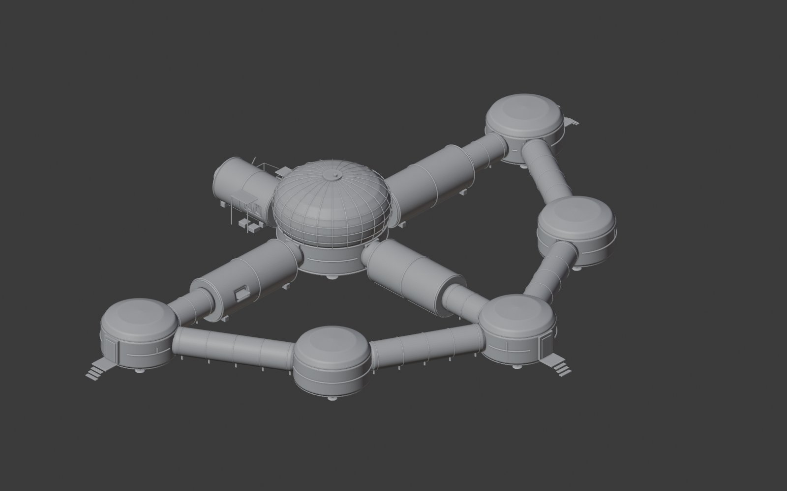
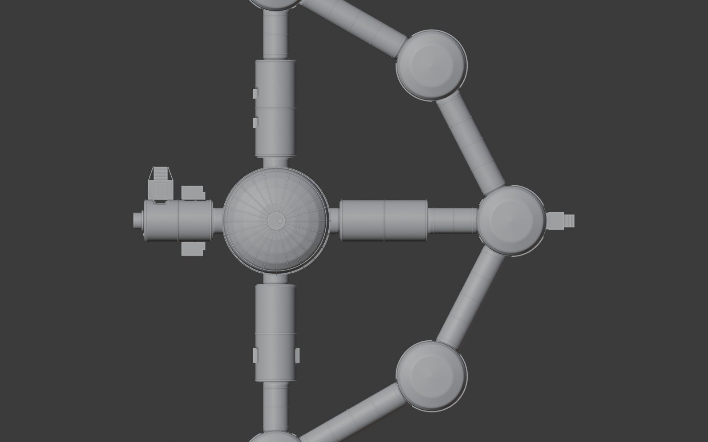

# Realistic habitat — bases only (STL)

`Lunar_Habitat_Realistic_BasesOnly_NoSleepPods_1-320.stl`, one file, ready to slice.

| | |
|---|---|
| What's in it | Central core (dome + lower deck), the four tunnels, the five ring nodes and ring tunnels, and the airlock |
| Left out | The four extra sleeping pods and their vestibule, the regolith shields, the comm tower, rovers, cargo, power units, cable trays and spacesuit figures |
| Scale | 1:320 (1 m in the real habitat = 3.125 mm) |
| Print size | about 142 × 198 × 28 mm |
| Units | millimetres |

**Print tips:** the model is made of many overlapping parts. Prusa, Bambu and Cura slicers merge them automatically (in Bambu/Prusa, accept "fix model" if asked). Print flat on the bed with supports on (build plate only is enough for the domes and tunnels), 0.12–0.16 mm layers. To print bigger, scale it up in the slicer: 160% gives about 32 cm on the long side.

Made from `Lunar_Smart_Adaptive_Habitat_BASE.blend` with Blender (the .blend was not changed).

© 2026 Jaineil R. — with thanks to Angel C. and Farhan K.
