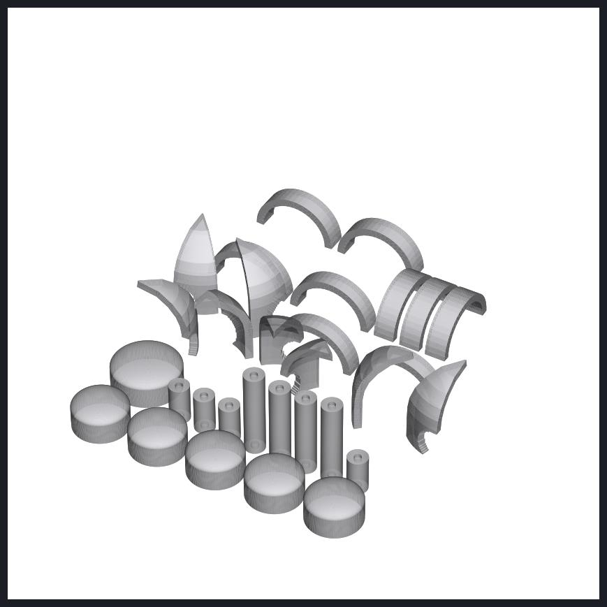

# Realistic habitat — 6 bases + hallways + regolith shield, as separate parts (STL)

`Lunar_Habitat_Realistic_Bases_Hallways_RegolithShield_SEPARATE_PARTS_1-150.stl` — one file, every piece laid out apart on the plate.

| Group | Pieces |
|---|---|
| Bases (the half-ring) | Command (N), Recreation Commons (R), Maintenance (E), Crew Support / Hygiene 2 (G), Medical / Storm Shelter (H), Quarters Vestibule (K) |
| Hallways | N01, E01, H01 (spokes) · L1 N→R · L2 R→E · L3 E→G · L4 G→H · K H→K — each has a magnet pocket in both ends |
| Lunar regolith protection | the 8 printed-regolith segments of the core dome shield + the printed-regolith arches over the lab (4), greenhouse (3) and wellness (2) modules — taken straight from the game model |

Left out: the four sleep-pod domes and their hallways, the core and modules themselves, and everything inside (all pieces are plain outer shapes).

Scale **1:150** (matches the Project 3 kit and its layout guide). The whole plate is ≈ 278 × 327 mm, so use your slicer's *split to plates / arrange* to spread it over 2 beds.

© 2026 Jaineil R. — with thanks to Angel C. and Farhan K.
