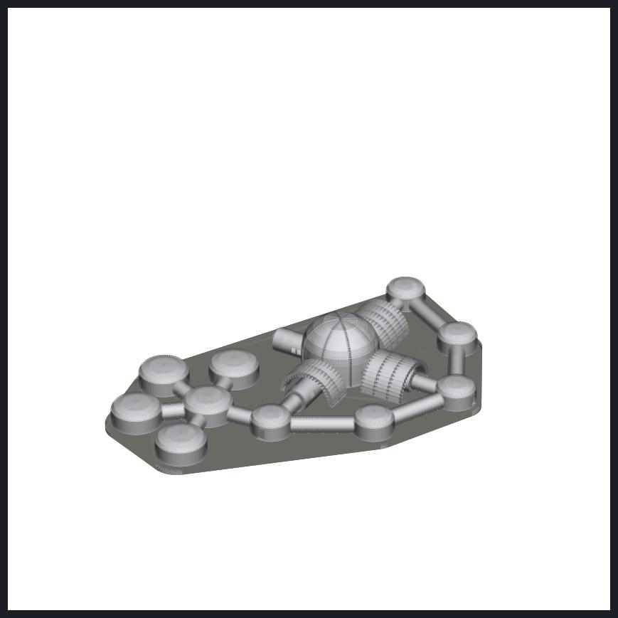
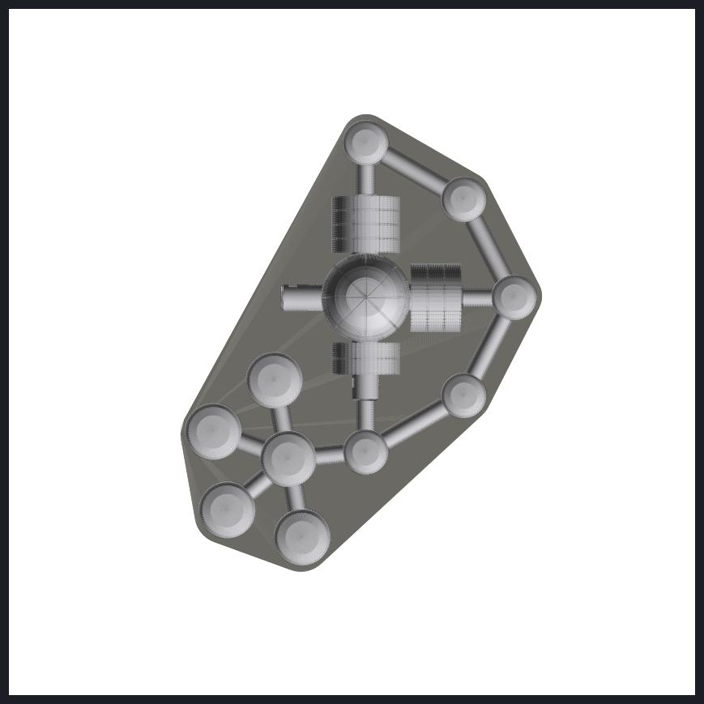

# Realistic habitat — outer shell + hallways + regolith protection (STL)

`Lunar_Habitat_Realistic_Shell_Hallways_RegolithShield_1-320.stl` — one file, ready to slice.

| | |
|---|---|
| What's in it | The outer hull of every part of the realistic (VR game) base, and **nothing inside**: the core (rigid lower deck + inflatable upper deck), the four modules (airlock, lab, greenhouse, wellness) with their MMOD shields and end hatches, the four short tunnels, all ring nodes, the quarters vestibule and the four sleep domes, every hallway with its supports — plus the **lunar regolith protection**: the 8 printed-regolith segments over the core dome and the printed-regolith arches over the lab, greenhouse and wellness modules |
| Left out | Everything inside (rooms, furniture, equipment), rovers, landing pad, solar towers, antennas |
| Base | a ground plate (the lunar surface) joins everything into one piece and closes the hull bottoms |
| Scale | 1:320 (1 m real = 3.125 mm) · walls 1.0 mm (regolith/MMOD 0.6 mm) |
| Print size | about 185 × 234 × 35 mm |
| Units | millimetres |

**Print tips:** the hulls are separate overlapping shells; Bambu Studio, PrusaSlicer and Cura merge them automatically (accept "fix model" if asked). Print flat, supports on (build plate only), 0.12–0.16 mm layers. Too big for your bed? Scale to 90 % (≈ 167 × 211 mm) or rotate 45°.

Made directly from the game model `LunarHabitat_Unity3_Habitat.fbx` with `tools/realistic_shell_stl.py`.

© 2026 Jaineil R. — with thanks to Angel C. and Farhan K.
