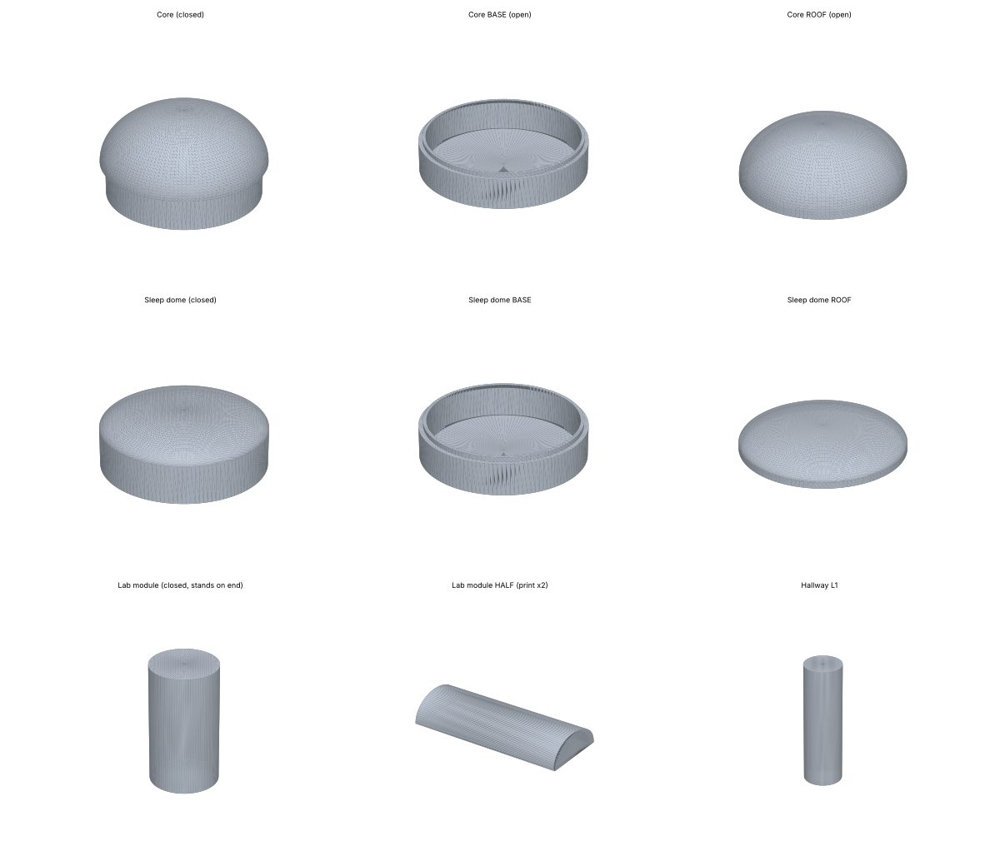

# Lunar Smart Adaptive Habitat — 3D print kit (STL)

Simple, print-ready STL parts of the **project 3** habitat (core, 4 modules, 6 nodes, 4 sleep domes, tunnels and hallways),
generated from the real layout used by the Unity simulator. Basic dome and cylinder shapes, nothing fancy.



- **Scale 1:150** — the whole base fits on a **2 ft × 2 ft (610 mm) board** (footprint ≈ 42 × 54 cm).
- Units are **millimetres**. Every file is watertight (checked) and prints **without supports**.
- **`closed/`**: sealed parts, the quickest print.
- **`open/`**: the same base, but you can lift the roofs off to put things inside (rooms, furniture, LEDs, sensors):
  - **Domes + core** = a hollow **BASE** with a small raised lip + a lift-off **ROOF** that slides over the lip.
  - **Modules** = a hollow **HALF** shell; print the file **twice**: one is the bottom, the other sits on top as the lid.
  - Tunnels and hallways stay solid (too thin to fit anything inside).
- **`00_LAYOUT_GUIDE_print_at_100_percent.svg`**: top view at true scale. Print it at 100 % (or at a print shop) and
  tape it to the board to know where every piece goes.

## Print settings (any FDM printer, PLA)
| Setting | Value |
|---|---|
| Layer height | 0.2 mm |
| Walls / perimeters | 3 |
| Infill | 10–15 % (closed set), 15 % (open set) |
| Supports | none |
| Orientation | as exported: domes/bases/roofs flat side down · closed modules & hallways stand on one end · module HALVES lie on their flat cut face |
| Filament | closed set ≈ 1022 cm³, open set ≈ 370 cm³ of plastic (solid volume; infill uses much less) |

If a roof is too tight or too loose on your printer, change `CLEAR` (default 0.35 mm) in `tools/make_print_kit.py`
and regenerate (see below).

## Assembly
1. Lay the layout guide on the board. Place the **core** in the centre, the **tunnels + modules** on its four sides
   (A airlock east, B lab north, C greenhouse west, D wellness south), the **nodes** on the ring, and the **quarters
   wing** (K vestibule + sleep domes SQ1–SQ4) to the south-east.
2. Lay the **hallways** on their side between the domes (file names say what they connect, e.g. `L1_N_to_R`).
3. Glue (or use museum putty) — in the open set, glue only the BASES and hallways so the roofs still lift off.

## Closed set
| File | Size (mm) | Print | What it is |
|---|---|---|---|
| `01_Core.stl` | 73 × 73 × 52 | ×1 | core habitat (rigid lower deck + inflatable upper deck) |
| `02_Module_Airlock_EVA.stl` | 28 × 28 × 47 | ×1 | Module Airlock EVA — print standing on one end |
| `02b_Tunnel_A.stl` | 18 × 18 × 18 | ×1 | tunnel core ↔ module A (solid) |
| `03_Module_Lab.stl` | 28 × 28 × 67 | ×1 | Module Lab — print standing on one end |
| `03b_Tunnel_B.stl` | 18 × 18 × 18 | ×1 | tunnel core ↔ module B (solid) |
| `04_Module_Greenhouse.stl` | 28 × 28 × 60 | ×1 | Module Greenhouse — print standing on one end |
| `04b_Tunnel_C.stl` | 18 × 18 × 18 | ×1 | tunnel core ↔ module C (solid) |
| `05_Module_Wellness.stl` | 28 × 28 × 67 | ×1 | Module Wellness — print standing on one end |
| `05b_Tunnel_D.stl` | 18 × 18 × 18 | ×1 | tunnel core ↔ module D (solid) |
| `06_Node_Command.stl` | 48 × 48 × 27 | ×1 | Node Command |
| `07_Node_Maintenance.stl` | 48 × 48 × 27 | ×1 | Node Maintenance |
| `08_Node_Medical_StormShelter.stl` | 48 × 48 × 27 | ×1 | Node Medical StormShelter |
| `09_Node_Recreation_Commons.stl` | 48 × 48 × 27 | ×1 | Node Recreation Commons |
| `10_Node_CrewSupport_Hygiene2.stl` | 48 × 48 × 27 | ×1 | Node CrewSupport Hygiene2 |
| `11_Node_Quarters_Vestibule.stl` | 60 × 60 × 27 | ×1 | Node Quarters Vestibule |
| `12_SleepDome_Quarters1.stl` | 60 × 60 × 27 | ×1 | SleepDome Quarters1 |
| `13_SleepDome_Quarters2.stl` | 60 × 60 × 27 | ×1 | SleepDome Quarters2 |
| `14_SleepDome_Quarters3.stl` | 60 × 60 × 27 | ×1 | SleepDome Quarters3 |
| `15_SleepDome_Quarters4.stl` | 60 × 60 × 27 | ×1 | SleepDome Quarters4 |
| `16_Hallway_N01_B_to_N.stl` | 18 × 18 × 34 | ×1 | hallway B → N (5.1 m real) — print standing on one end |
| `17_Hallway_H01_D_to_H.stl` | 18 × 18 × 34 | ×1 | hallway D → H (5.1 m real) — print standing on one end |
| `18_Hallway_E01_C_to_E.stl` | 18 × 18 × 34 | ×1 | hallway C → E (5.1 m real) — print standing on one end |
| `19_Hallway_L1_N_to_R.stl` | 18 × 18 × 76 | ×1 | hallway N → R (11.5 m real) — print standing on one end |
| `20_Hallway_L2_R_to_E.stl` | 18 × 18 × 73 | ×1 | hallway R → E (11.0 m real) — print standing on one end |
| `21_Hallway_L3_E_to_G.stl` | 18 × 18 × 73 | ×1 | hallway E → G (11.0 m real) — print standing on one end |
| `22_Hallway_L4_G_to_H.stl` | 18 × 18 × 76 | ×1 | hallway G → H (11.5 m real) — print standing on one end |
| `23_Hallway_K_H_to_K.stl` | 18 × 18 × 32 | ×1 | hallway H → K (4.8 m real) — print standing on one end |
| `24_Hallway_SQ1_K_to_SQ1.stl` | 18 × 18 × 28 | ×1 | hallway K → SQ1 (4.3 m real) — print standing on one end |
| `25_Hallway_SQ2_K_to_SQ2.stl` | 18 × 18 × 28 | ×1 | hallway K → SQ2 (4.3 m real) — print standing on one end |
| `26_Hallway_SQ3_K_to_SQ3.stl` | 18 × 18 × 28 | ×1 | hallway K → SQ3 (4.3 m real) — print standing on one end |
| `27_Hallway_SQ4_K_to_SQ4.stl` | 18 × 18 × 28 | ×1 | hallway K → SQ4 (4.3 m real) — print standing on one end |

## Open set
| File | Size (mm) | Print | What it is |
|---|---|---|---|
| `01_Core_BASE.stl` | 68 × 68 × 19 | ×1 | core lower deck, hollow, with locating lip |
| `01_Core_ROOF.stl` | 73 × 73 × 34 | ×1 | core inflatable upper deck, lift-off roof |
| `02_Module_Airlock_EVA_HALF_print_x2.stl` | 47 × 28 × 14 | ×2 | Module Airlock EVA — hollow half; print TWO (one is the lid) |
| `02b_Tunnel_A.stl` | 18 × 18 × 18 | ×1 | tunnel core ↔ module A (solid) |
| `03_Module_Lab_HALF_print_x2.stl` | 67 × 28 × 14 | ×2 | Module Lab — hollow half; print TWO (one is the lid) |
| `03b_Tunnel_B.stl` | 18 × 18 × 18 | ×1 | tunnel core ↔ module B (solid) |
| `04_Module_Greenhouse_HALF_print_x2.stl` | 60 × 28 × 14 | ×2 | Module Greenhouse — hollow half; print TWO (one is the lid) |
| `04b_Tunnel_C.stl` | 18 × 18 × 18 | ×1 | tunnel core ↔ module C (solid) |
| `05_Module_Wellness_HALF_print_x2.stl` | 67 × 28 × 14 | ×2 | Module Wellness — hollow half; print TWO (one is the lid) |
| `05b_Tunnel_D.stl` | 18 × 18 × 18 | ×1 | tunnel core ↔ module D (solid) |
| `06_Node_Command_BASE.stl` | 48 × 48 × 18 | ×1 | Node Command — hollow base with lip |
| `06_Node_Command_ROOF.stl` | 48 × 48 × 11 | ×1 | Node Command — lift-off dome roof |
| `07_Node_Maintenance_BASE.stl` | 48 × 48 × 18 | ×1 | Node Maintenance — hollow base with lip |
| `07_Node_Maintenance_ROOF.stl` | 48 × 48 × 11 | ×1 | Node Maintenance — lift-off dome roof |
| `08_Node_Medical_StormShelter_BASE.stl` | 48 × 48 × 18 | ×1 | Node Medical StormShelter — hollow base with lip |
| `08_Node_Medical_StormShelter_ROOF.stl` | 48 × 48 × 11 | ×1 | Node Medical StormShelter — lift-off dome roof |
| `09_Node_Recreation_Commons_BASE.stl` | 48 × 48 × 18 | ×1 | Node Recreation Commons — hollow base with lip |
| `09_Node_Recreation_Commons_ROOF.stl` | 48 × 48 × 11 | ×1 | Node Recreation Commons — lift-off dome roof |
| `10_Node_CrewSupport_Hygiene2_BASE.stl` | 48 × 48 × 18 | ×1 | Node CrewSupport Hygiene2 — hollow base with lip |
| `10_Node_CrewSupport_Hygiene2_ROOF.stl` | 48 × 48 × 11 | ×1 | Node CrewSupport Hygiene2 — lift-off dome roof |
| `11_Node_Quarters_Vestibule_BASE.stl` | 60 × 60 × 18 | ×1 | Node Quarters Vestibule — hollow base with lip |
| `11_Node_Quarters_Vestibule_ROOF.stl` | 60 × 60 × 11 | ×1 | Node Quarters Vestibule — lift-off dome roof |
| `12_SleepDome_Quarters1_BASE.stl` | 60 × 60 × 18 | ×1 | SleepDome Quarters1 — hollow base with lip |
| `12_SleepDome_Quarters1_ROOF.stl` | 60 × 60 × 11 | ×1 | SleepDome Quarters1 — lift-off dome roof |
| `13_SleepDome_Quarters2_BASE.stl` | 60 × 60 × 18 | ×1 | SleepDome Quarters2 — hollow base with lip |
| `13_SleepDome_Quarters2_ROOF.stl` | 60 × 60 × 11 | ×1 | SleepDome Quarters2 — lift-off dome roof |
| `14_SleepDome_Quarters3_BASE.stl` | 60 × 60 × 18 | ×1 | SleepDome Quarters3 — hollow base with lip |
| `14_SleepDome_Quarters3_ROOF.stl` | 60 × 60 × 11 | ×1 | SleepDome Quarters3 — lift-off dome roof |
| `15_SleepDome_Quarters4_BASE.stl` | 60 × 60 × 18 | ×1 | SleepDome Quarters4 — hollow base with lip |
| `15_SleepDome_Quarters4_ROOF.stl` | 60 × 60 × 11 | ×1 | SleepDome Quarters4 — lift-off dome roof |
| `16_Hallway_N01_B_to_N.stl` | 18 × 18 × 34 | ×1 | hallway B → N (5.1 m real) — print standing on one end |
| `17_Hallway_H01_D_to_H.stl` | 18 × 18 × 34 | ×1 | hallway D → H (5.1 m real) — print standing on one end |
| `18_Hallway_E01_C_to_E.stl` | 18 × 18 × 34 | ×1 | hallway C → E (5.1 m real) — print standing on one end |
| `19_Hallway_L1_N_to_R.stl` | 18 × 18 × 76 | ×1 | hallway N → R (11.5 m real) — print standing on one end |
| `20_Hallway_L2_R_to_E.stl` | 18 × 18 × 73 | ×1 | hallway R → E (11.0 m real) — print standing on one end |
| `21_Hallway_L3_E_to_G.stl` | 18 × 18 × 73 | ×1 | hallway E → G (11.0 m real) — print standing on one end |
| `22_Hallway_L4_G_to_H.stl` | 18 × 18 × 76 | ×1 | hallway G → H (11.5 m real) — print standing on one end |
| `23_Hallway_K_H_to_K.stl` | 18 × 18 × 32 | ×1 | hallway H → K (4.8 m real) — print standing on one end |
| `24_Hallway_SQ1_K_to_SQ1.stl` | 18 × 18 × 28 | ×1 | hallway K → SQ1 (4.3 m real) — print standing on one end |
| `25_Hallway_SQ2_K_to_SQ2.stl` | 18 × 18 × 28 | ×1 | hallway K → SQ2 (4.3 m real) — print standing on one end |
| `26_Hallway_SQ3_K_to_SQ3.stl` | 18 × 18 × 28 | ×1 | hallway K → SQ3 (4.3 m real) — print standing on one end |
| `27_Hallway_SQ4_K_to_SQ4.stl` | 18 × 18 × 28 | ×1 | hallway K → SQ4 (4.3 m real) — print standing on one end |

## Regenerate / change the scale
```
python3 tools/make_print_kit.py layout_export.json OUT_FOLDER 150   # last number = scale 1:N (100 = bigger, needs a bigger board)
python3 tools/preview.py OUT_FOLDER preview.png
```
`layout_export.json` comes from the Unity project (`Assets/Unity3/layout_export.json`).

Made for NASA HUNCH — Project ARES · Jaineil R., Angel C., Farhan K.
