# Code highlights: the code that runs both games

These are the most important pieces of code in our two NASA HUNCH games, with a plain-English explanation of each one. You don't need to know C# to follow along: each picture shows the real code (with its file and line numbers), and the notes underneath say what it does, why we built it that way, and when it runs.

- **Game 1 — Realistic (Moon Base Final):** [play it](https://jaigod.github.io/ares-site/play/) · [all scripts](../../Unity_Game_Moon_Base_Final/Assets/Unity3/Scripts/README.md)
- **Game 2 — Sci-fi (Lunar Habitat Commander):** [play it](https://jaigod.github.io/ares-site/play2/) · [all scripts](../Lunar_Habitat_Commander/Unity_Scripts/README.md)
- **Website version of this page:** [code.html](https://jaigod.github.io/ares-site/code.html) · **[PDF to print or share](Code_Highlights_Both_Games.pdf)**

**The big idea behind both games:** the AI looks after the crew's mental health, but it always asks before it acts, and a human can switch it off at any moment. When something goes wrong while the crew is asleep, the AI stops and a person takes over.


## Game 1 · Realistic — Moon Base Final

### 1. Turning sensor readings into a wellbeing score

[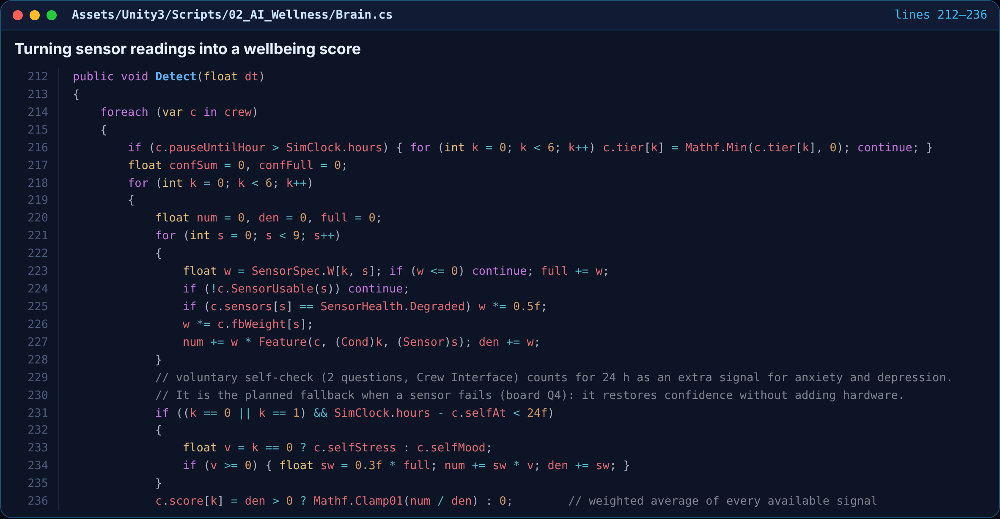](img/r1_sensors.png)

📄 [`Brain.cs`](../../Unity_Game_Moon_Base_Final/Assets/Unity3/Scripts/02_AI_Wellness/Brain.cs) · lines 212–236

**What it does:** This is where the AI actually reads the crew. Every astronaut has 9 sensors (wristband, sleep tracker, voice, CO₂, movement and so on). For each of the 6 conditions we watch (anxiety, depression, fatigue, conflict, monotony and loss of autonomy), the code takes a weighted average of whichever sensors are working right now.

**Why it matters:**
- A broken sensor is skipped and a glitchy one only counts half, so one bad reading can't panic the system.
- If someone says “that reading is wrong”, `fbWeight` lowers that sensor's say for them. The crew can correct the AI.
- The optional 2-question self-check counts as an extra signal for 24 hours. It's our backup plan when a sensor fails.

**When it runs:** Every simulated minute, for all 4 crew. It feeds the crew health dashboard, the dome lights and the AI's decisions.

### 2. Deciding how worried to be (Tier 0–3), carefully

[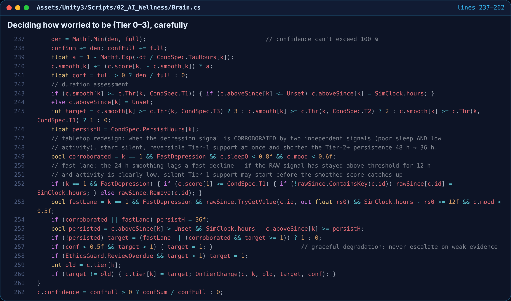](img/r2_tiers.png)

📄 [`Brain.cs`](../../Unity_Game_Moon_Base_Final/Assets/Unity3/Scripts/02_AI_Wellness/Brain.cs) · lines 237–262

**What it does:** Once there's a score, the AI picks a response tier: 0 = fine, 1 = small silent tweak, 2 = ask the person, 3 = get a human (the medical officer or commander). It only moves up a tier if the score stays high for long enough, not because of one bad hour.

**Why it matters:**
- `persisted` means an issue has to last (for example 48 hours for depression) before the AI gets more involved.
- Graceful degradation: if fewer than half the sensors are trustworthy, it never goes above Tier 1.
- If the weekly human review of the AI is overdue, it's capped at Tier 1 too. Humans stay in charge.

**When it runs:** Straight after the scores are updated. A tier change calls `OnTierChange`, which starts or stops a response.

### 3. Asking before acting: consent and the “agency test”

[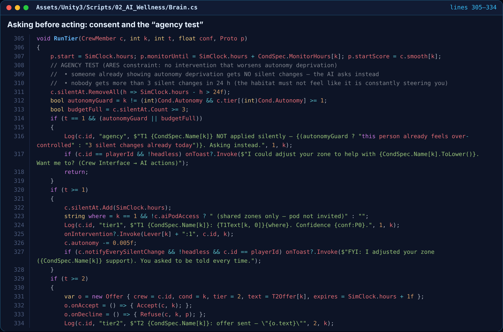](img/r3_consent.png)

📄 [`Brain.cs`](../../Unity_Game_Moon_Base_Final/Assets/Unity3/Scripts/02_AI_Wellness/Brain.cs) · lines 305–334

**What it does:** This runs a response. Tier 1 is a small, reversible change, like warmer light or quieter sound in someone's zone. Tier 2 is an offer the person can accept or say no to. Before doing anything quietly, the AI checks it isn't making someone feel controlled.

**Why it matters:**
- If a person already shows signs of feeling over-controlled, the AI doesn't change things silently. It asks instead.
- No one gets more than 3 silent changes in 24 hours, so the habitat never feels like it's steering you.
- AI crewmates decide on offers based on their own autonomy, so saying “no” is part of the simulation.

**When it runs:** Whenever a crew member moves up a tier. Offers to the player pop up in VR or on screen as Y / N.

### 4. The human OFF switch

[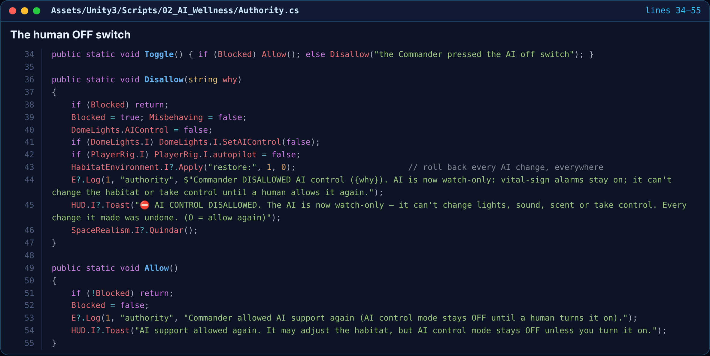](img/r4_offswitch.png)

📄 [`Authority.cs`](../../Unity_Game_Moon_Base_Final/Assets/Unity3/Scripts/02_AI_Wellness/Authority.cs) · lines 34–55

**What it does:** Press O (or use the VR menu) and the AI becomes watch-only. It instantly undoes every change it made, stops AI control and autopilot, and logs who switched it off and why. Only a human can turn it back on.

**Why it matters:**
- Life-safety alarms (vital signs, fire, air) stay on even when the AI is off. Safety is never switched off.
- Turning it back on brings AI support back, but AI control mode stays off until a person chooses it again.
- This is the rubric's D4 requirement: human override plus hard limits.

**When it runs:** From the keyboard, the VR menu, the Crew Interface, or automatically from the night watch below.

### 5. Night watch: if anything goes wrong while you sleep, the AI stops

[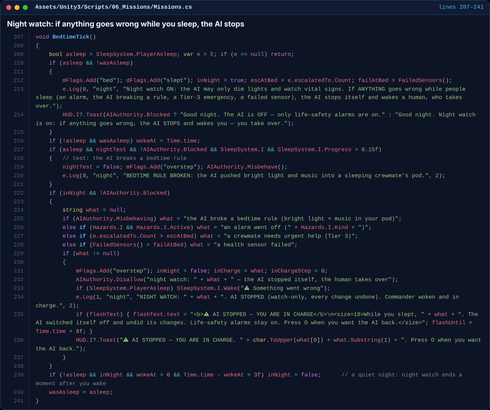](img/r5_nightwatch.png)

📄 [`Missions.cs`](../../Unity_Game_Moon_Base_Final/Assets/Unity3/Scripts/06_Missions/Missions.cs) · lines 207–241

**What it does:** While the crew sleeps, the AI may only dim lights and watch vital signs. This loop checks for trouble: the AI breaking a bedtime rule, an alarm, a crewmate needing urgent help, or a sensor failing. If any of these happens, the AI switches itself off, wakes the commander, and tells them they're in charge.

**Why it matters:**
- This is the rule we kept coming back to: when something goes wrong during sleep, the AI stops and the human takes over.
- There's a test button for the review board that makes the AI misbehave on purpose, so you can watch it get caught.
- After a quiet night, the night watch ends on its own a few seconds after you wake up.

**When it runs:** Twice a second, all game. It only acts while someone is asleep.

### 6. Sleeping in your pod: one real minute = one whole night

[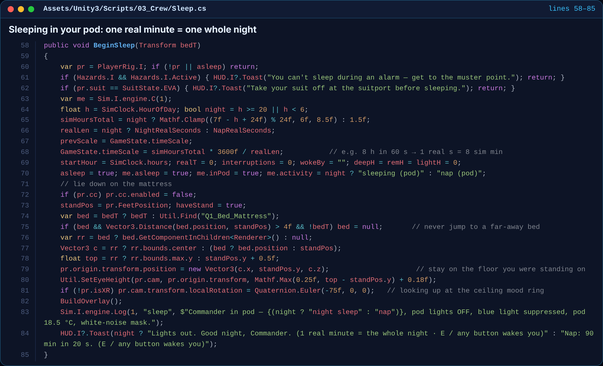](img/r6_sleep.png)

📄 [`Sleep.cs`](../../Unity_Game_Moon_Base_Final/Assets/Unity3/Scripts/03_Crew/Sleep.cs) · lines 58–85

**What it does:** When you lie down in your sleep dome, time speeds up so 8 hours pass in about 60 real seconds. The pod lights go out (just a dim amber night-light), the camera looks up at the mood ring on the ceiling, and your wristband records deep, REM and light sleep.

**Why it matters:**
- You can't sleep during an alarm or while wearing an EVA suit. That's a realistic safety rule.
- You wake up exactly where you lay down (same bed, same deck). This fixed the old “teleported downstairs” bug.
- Sleep quality comes out of stress and interruptions, and feeds back into the AI's fatigue score.

**When it runs:** When you use a bed. Any button, or any hazard, wakes you.


## Game 2 · Sci-fi — Lunar Habitat Commander

### 7. How life on the Moon wears on the crew

[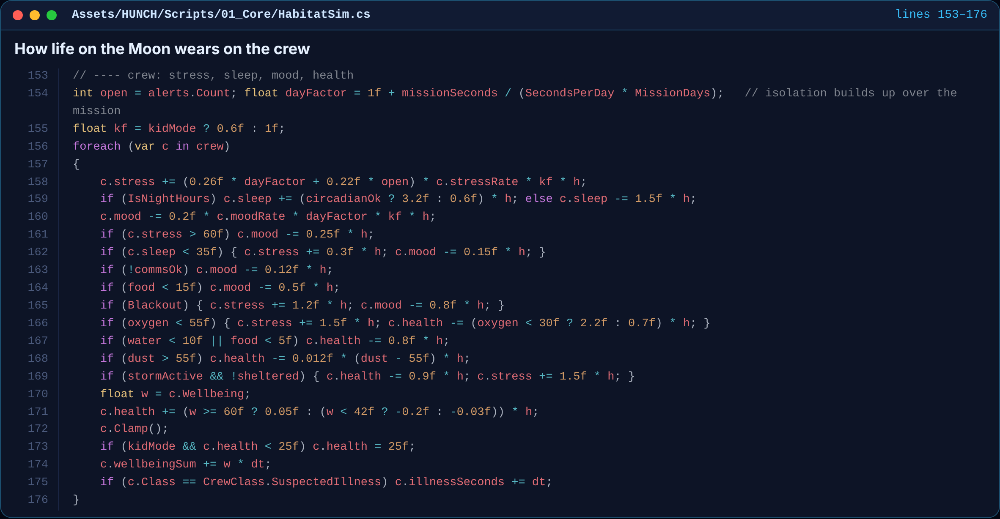](img/s1_crew.png)

📄 [`HabitatSim.cs`](../../Docs/Lunar_Habitat_Commander/Unity_Scripts/01_Core/HabitatSim.cs) · lines 153–176

**What it does:** This is the heart of the simulation. Every in-game hour, each astronaut's stress, sleep, mood and health change based on what's happening in the base: open alerts, how far into the mission they are (isolation builds up), lunar night, low oxygen, dust, food, broken comms and solar storms.

**Why it matters:**
- The numbers come from our research proposal, so the game shows real causes of poor mental health on a mission.
- Kid mode (`kf`) softens everything so younger players can still finish.
- Wellbeing slowly heals health when it's good and drains it when it's bad, so mental health really matters.

**When it runs:** Every frame during a mission. One real second is one habitat hour.

### 8. Keeping the base alive: power, air, water, food and storms

[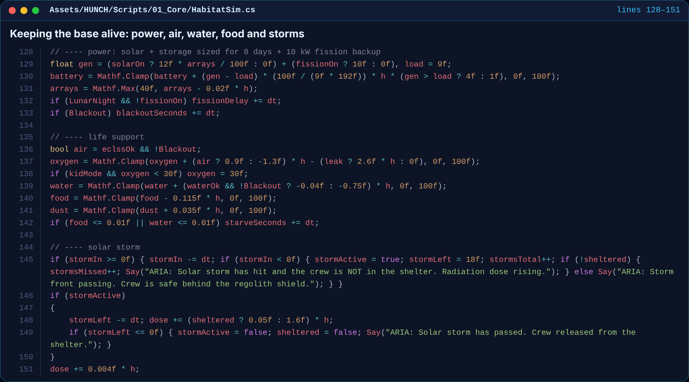](img/s2_life.png)

📄 [`HabitatSim.cs`](../../Docs/Lunar_Habitat_Commander/Unity_Scripts/01_Core/HabitatSim.cs) · lines 128–151

**What it does:** Before the crew update, the base itself is simulated. Solar panels and the fission backup charge the battery, the ECLSS life support adds oxygen, and water, food and dust change over time. A solar storm doses anyone not in the shelter with radiation.

**Why it matters:**
- The battery is sized for 8 days, but lunar night is 9, so you have to start the fission backup. That's a real planning problem.
- A leak or a blackout drains oxygen fast, which raises stress in the crew code above.
- ARIA warns you about each event out loud with `Say(...)`.

**When it runs:** Every frame during a mission, just before the crew update.

### 9. ARIA predicts who is about to struggle

[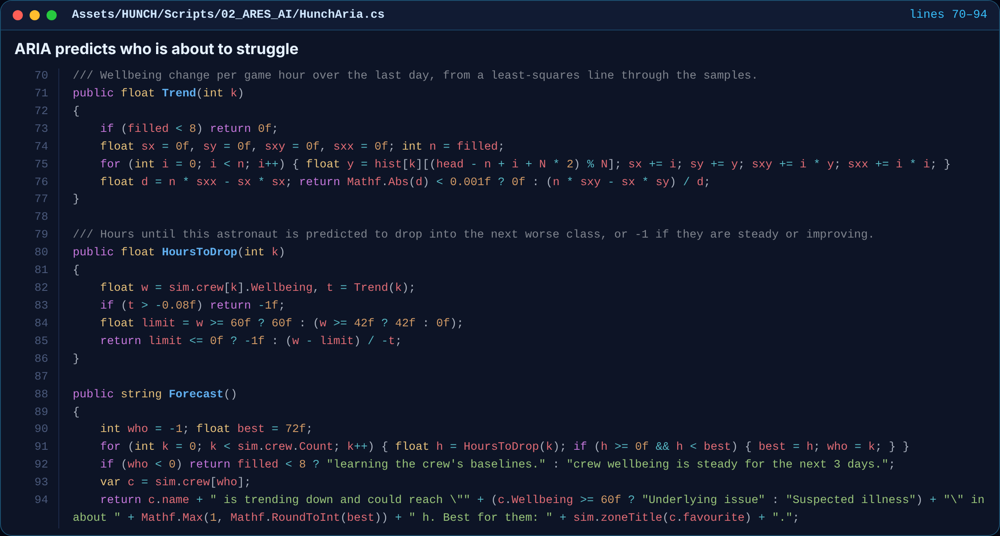](img/s3_forecast.png)

📄 [`HunchAria.cs`](../../Docs/Lunar_Habitat_Commander/Unity_Scripts/02_ARES_AI/HunchAria.cs) · lines 70–94

**What it does:** ARIA, the habitat AI, keeps a day of wellbeing history for each astronaut and fits a straight trend line through it. If someone is trending down, it works out roughly how many hours until they drop into “Underlying issue” or “Suspected illness”, and warns the commander early.

**Why it matters:**
- It's a simple math rule (least squares), not a cloud chatbot. It works offline and always gives the same answer for the same situation.
- It says “learning the crew's baselines” until it has enough data, so it never guesses.

**When it runs:** Continuously. The forecast is shown on ARIA's panel and in the crew health dashboard.

### 10. ARIA tells the commander what to do next, and why

[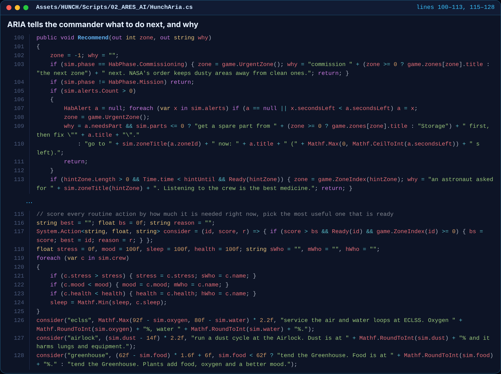](img/s4_advice.png)

📄 [`HunchAria.cs`](../../Docs/Lunar_Habitat_Commander/Unity_Scripts/02_ARES_AI/HunchAria.cs) · lines 100–113, 115–128

**What it does:** ARIA ranks what you should do right now: emergencies first (the alert with the least time left), then the crew, then routine systems. Every routine job gets a “how needed is this?” score, and ARIA picks the most useful one that isn't on cooldown.

**Why it matters:**
- It always gives a reason (for example “Dust is at 70% and it harms lungs and equipment”), so the player learns why, not just what.
- If an alert needs a spare part and you have none, it sends you to Storage first.
- The green guide arrows and Autopilot both follow this advice.

**When it runs:** Whenever the HUD refreshes or the player asks ARIA for advice.

### 11. Privacy-aware sensors in every zone (centre dorm kept)

[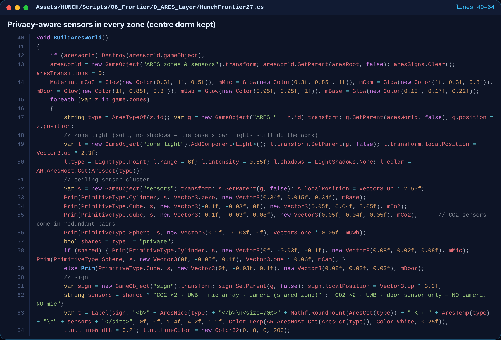](img/s5_zones.png)

📄 [`HunchFrontier27.cs`](../../Docs/Lunar_Habitat_Commander/Unity_Scripts/06_Frontier/D_ARES_Layer/HunchFrontier27.cs) · lines 40–64

**What it does:** This places the Project ARES design inside the 3D base. Each module gets its zone light (warm for social areas, cool for work areas) and a ceiling sensor cluster showing what's installed there. Shared rooms get a mic array and camera. Private quarters get only a door sensor: no camera, no mic.

**Why it matters:**
- It answers the ethics part of the rubric visually: you can walk around and see where the AI can and can't listen.
- Nothing in the base is moved. The central dorm stays exactly where it was, as we asked.
- Floating signs name each zone's type, light temperature and sensors.

**When it runs:** Once when the base loads. It can be toggled from the Project ARES menu.

### 12. Mobile controls: the whole game with three buttons

[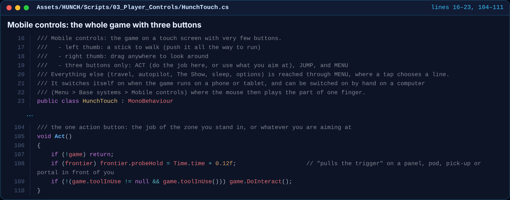](img/s6_touch.png)

📄 [`HunchTouch.cs`](../../Docs/Lunar_Habitat_Commander/Unity_Scripts/03_Player_Controls/HunchTouch.cs) · lines 16–23, 104–111

**What it does:** This is what makes the game playable on a phone or tablet. Your left thumb is a walk stick, your right thumb drags to look around, and there are only three buttons: ACT, JUMP and MENU. ACT is smart: it does the job of the zone you're standing in, or uses whatever you're aiming at.

**Why it matters:**
- It turns itself on for touch screens, and on a PC the mouse acts as one finger, so it's easy to test.
- Everything else (travel, autopilot, sleep, options) lives in MENU, so the screen stays clean and easy for kids.

**When it runs:** Every frame when mobile controls are on (in the browser on Unity Play and GitHub Pages).


## How the pieces fit together

```
 Sensors on each astronaut ──► Detect() scores 6 conditions ──► Tier 0 / 1 / 2 / 3
                                                                    │
            silent small tweak ◄── Tier 1 (agency test first) ◄─────┤
            offer you can refuse ◄── Tier 2 (consent) ◄─────────────┤
            human medical officer ◄── Tier 3 (escalate) ◄───────────┘
                                                                    
 Human OFF switch (O)  ──► AI becomes watch-only, every change undone
 Night watch          ──► anything goes wrong while asleep → AI stops, you're woken and in charge
```


---
© 2026 Jaineil R. — with thanks to Angel C. and Farhan K.
