# Agency Review Board presentation — slide by slide

Full deck: [Presentation_Agency_Review_Board.pdf](Presentation_Agency_Review_Board.pdf) (19 slides). Speaker notes are in the live deck.

## 1. Title

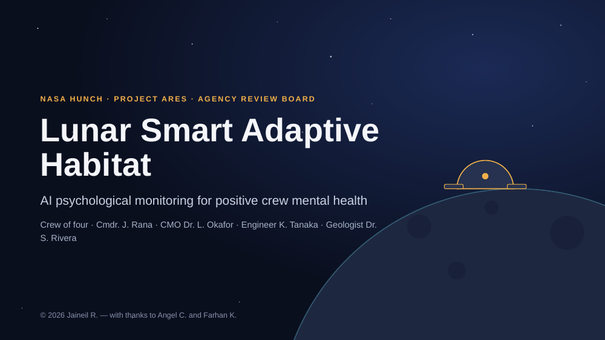

## 2. The six conditions

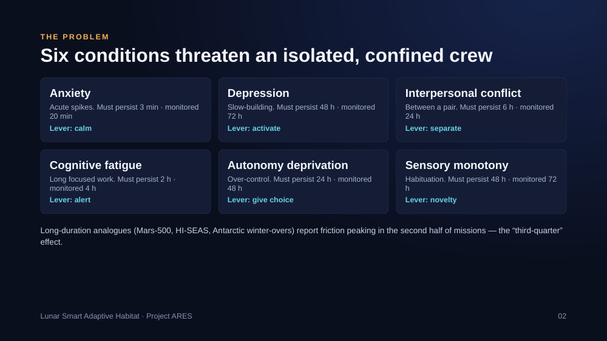

## 3. Three design principles

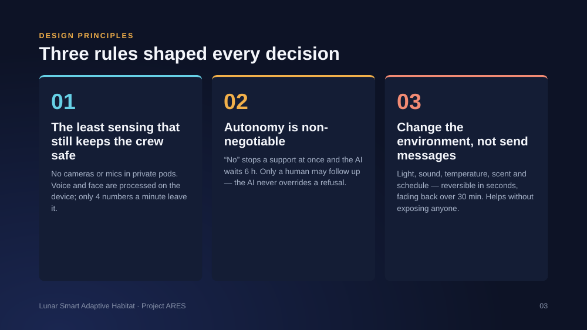

## 4. The simulator — six places in the final habitat

## 5. Earlier version — Lunar Habitat Commander (project 2)

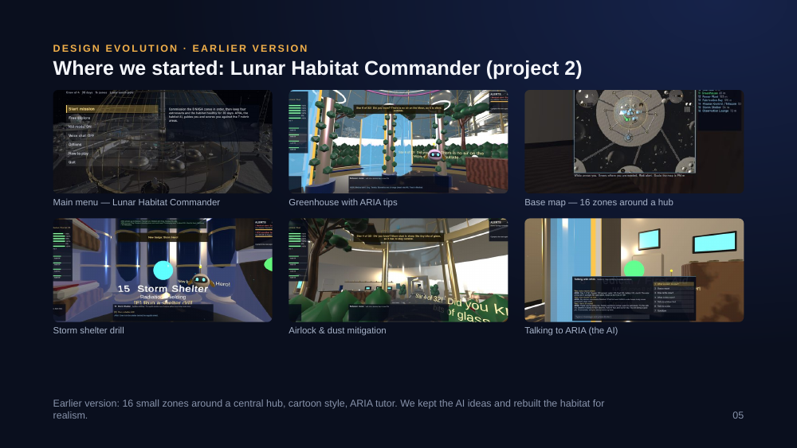

## 6. D1 · Sensor matrix

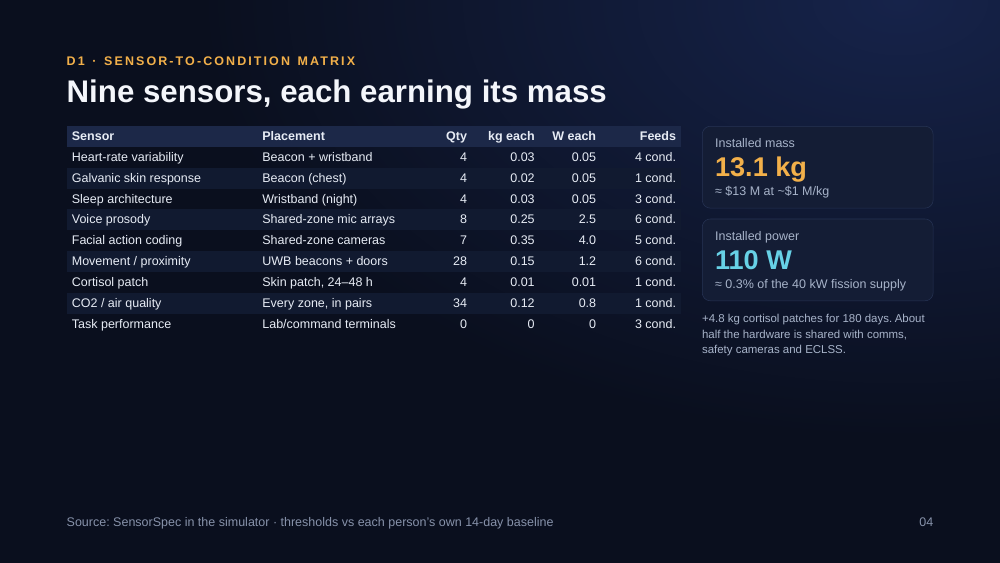

## 7. D1 · False positives & graceful degradation

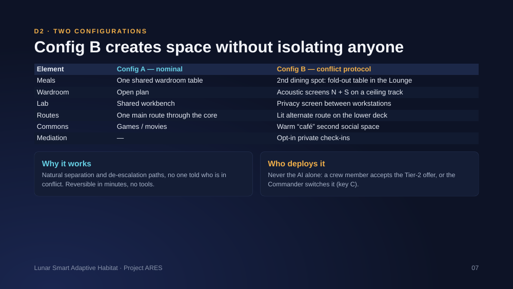

## 8. D2 · Six ARES zones

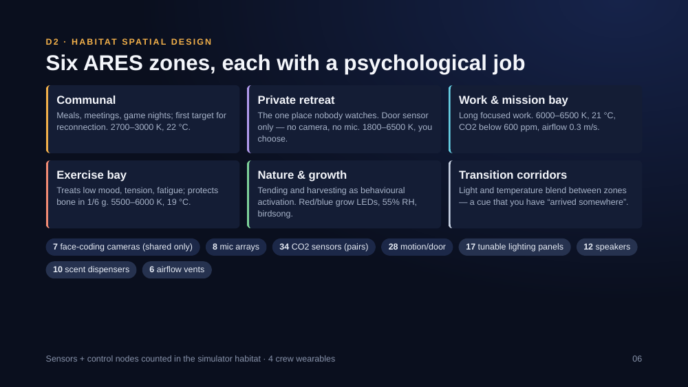

## 9. D2 · Config A vs B

## 10. D3 · Three-tier triage

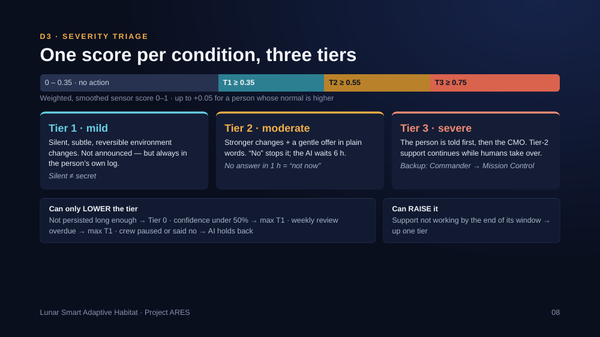

## 11. D3 · Anxiety flowchart (9 stages)

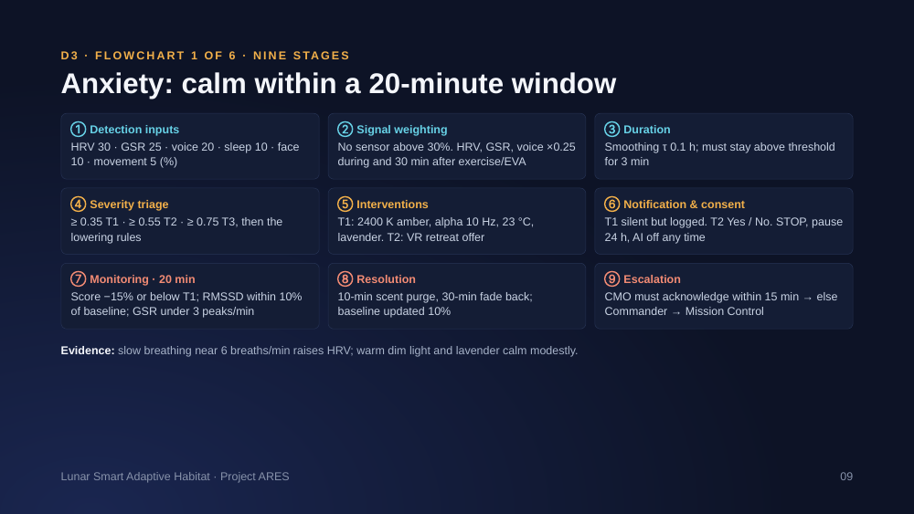

## 12. D3 · Depression flowchart (9 stages)

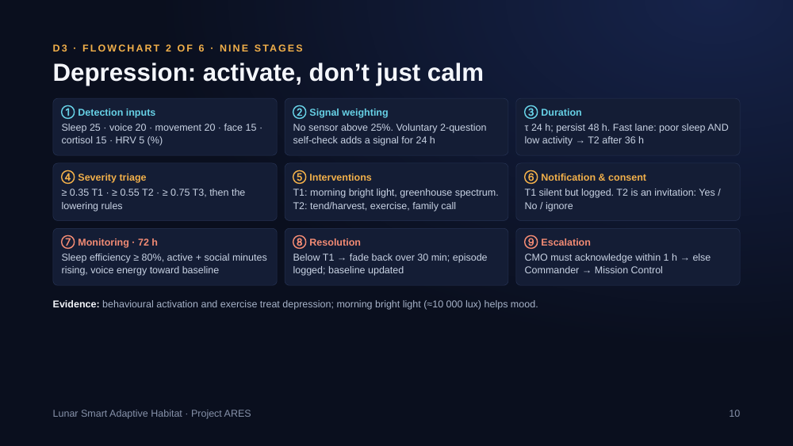

## 13. D3 · Environmental levers

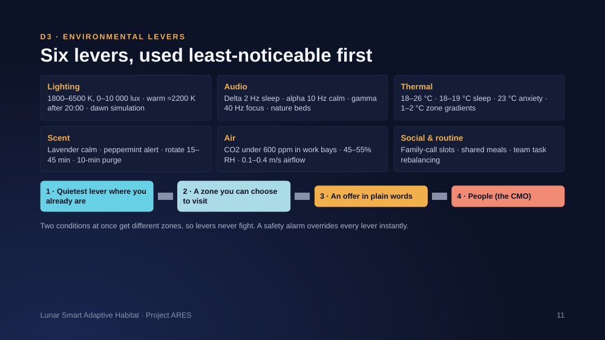

## 14. D3 · Escalation pathway

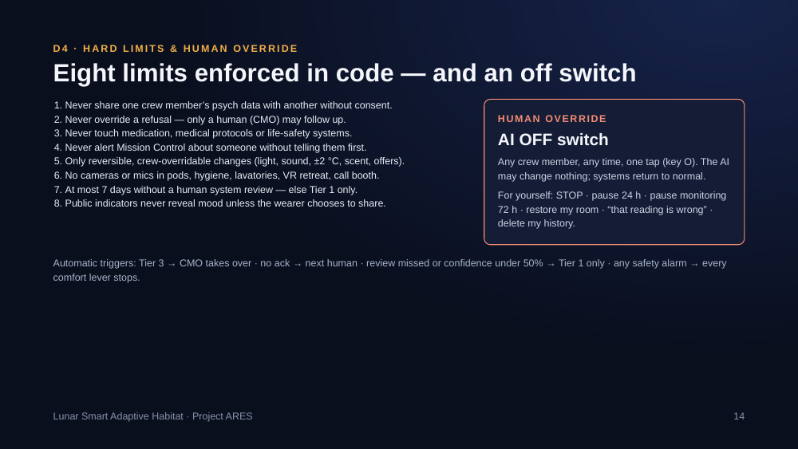

## 15. D4 · Four ethical tensions

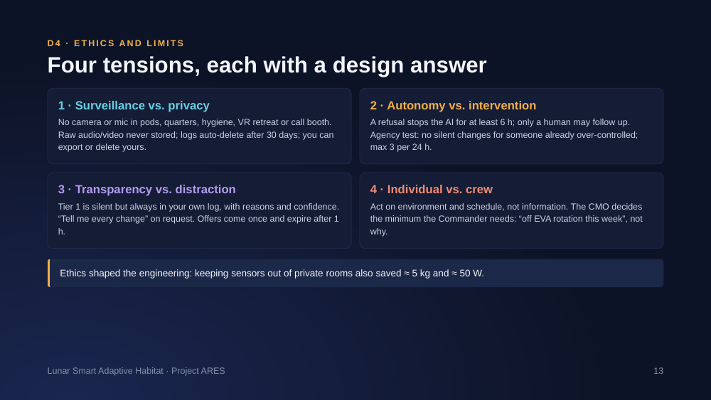

## 16. D4 · Hard limits & human override

## 17. Live demo plan

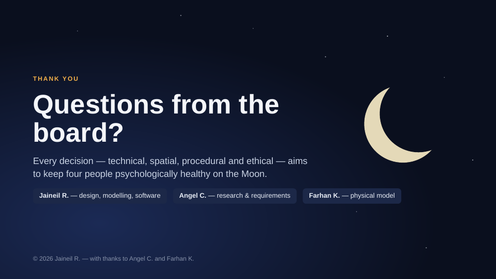

## 18. Board Q&A (Q1–Q6)

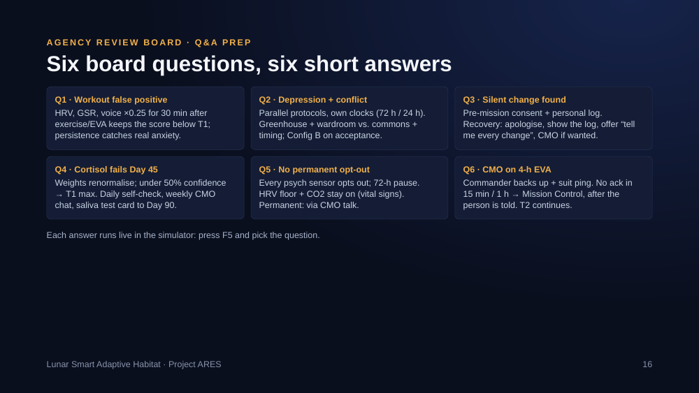

## 19. Thank you

---
© 2026 Jaineil R. — with thanks to Angel C. and Farhan K.
