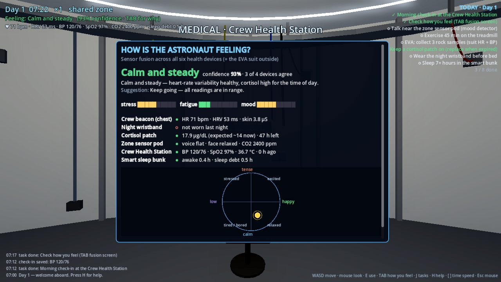

# Crew Health Sim (Godot 4)

**Play in the browser:** https://jaigod.github.io/ares-site/godot/

This is the third Project ARES simulator. It's a 3D first-person game (no VR) about one thing: **how the habitat can tell how an astronaut feels.** You live a mission day in a lunar module. Six health devices watch over you, and your choices (sleep, exercise, EVA, meals, calls home) change your body and your mood.



## What's in it

| Device / system | Where | What you do | What it measures |
|---|---|---|---|
| Smart sleep bunk | Crew quarters (private) | **E** to sleep. Time runs fast (**F** even faster, **Space** to wake) | Sleep stages from the mattress sensor, plus the circadian mood light |
| Night wristband | Shelf by the bunk | Put it on before bed | Light, deep (N3) and REM sleep, wake-ups, sleep score, hypnogram |
| Crew Health Station | Medical | Daily check-in | Live 2-lead ECG, blood pressure, SpO2, temperature, HRV |
| Zone sensor pod | Wardroom ceiling | Mood detector panel | Voice + face give valence and arousal. It only runs in shared zones, on the device, with a consent switch |
| Cortisol patch | Wardroom table | Replace it every 48 h | Stress hormone vs. the expected value for the time of day |
| Crew beacon | Worn on the chest (dock on the shelf) | Always on | Heart rate, HRV, skin conductance |
| EVA suit | Airlock | Suit up and go outside | Suit heart rate + blood pressure detector, O2 tank, helmet CO2, suit temperature, metabolic rate |
| **Fusion screen** | **TAB**, anywhere | Read it | All devices weighed into one read-out ("Calm and steady", "Tired", "Stressed", "Low mood", "Working hard on EVA"…), with a confidence score, how many devices agree, why, and a suggestion |

The habitat itself has:
- **Wires**: a ceiling cable tray running all the way round, with colour-coded power, data, fibre and sensor-bus cables, cable ties, hangers, and service loops dropping to wall junction boxes.
- Cables from the tray down to every device: the bunk, the health station (plus its ECG lead and BP hose), the console, the suit umbilical and the treadmill bungees.
- Power conduit to the wall outlets, and a solar-mast power cable on the surface.
- Circadian LED rings (cool white by day, amber at night) and a red CO2 alarm light.
- A treadmill, a crew console (meal, call home, work block, CO2 drill), and a lunar surface at 1.62 m/s² with 3 rock samples to collect.

## The body model (`scripts/astro.gd`)

Simulated minute by minute:
- Sleep pressure and the circadian clock.
- Sleep debt.
- Stress (acute and chronic).
- Mood (valence/arousal).
- Hunger, connection with home, and cabin CO2.

From these it derives:
- HR, HRV, BP, SpO2, breathing rate, core and skin temperature, and skin conductance.
- Cortisol, with an awakening response and a daily curve.

Sleep runs in 90-minute cycles: deep sleep comes early in the night and REM later. High CO2, stress or the wrong time of day cause wake-ups.

`scripts/fusion.gd` turns each device's reading into stress, fatigue and mood votes. Each vote is weighted by how trustworthy the device is right now: a worn beacon counts more than a stale check-in, and the mood pod only counts with consent. The result is one answer.

## Controls

WASD move · mouse look (click to capture) · **E** use · **TAB** how you feel · **J** tasks · **H** help · **Shift** run · **Space** jump · **[ ]** time speed · **Esc** free the mouse

## Build

- Godot **4.3**, Compatibility renderer, so it runs in WebGL 2.
- Open `project.godot`, or export from the command line:

```
godot --headless --path . --export-release "Web" ../godot/index.html
```

The web export uses the no-threads template, so it runs on GitHub Pages without special headers.

© 2026 Jaineil R. — with thanks to Angel C. and Farhan K.
