# NASA HUNCH: Lunar Smart Adaptive Habitat

> 📂 **The 6 final files are in [`00_FINAL_FILES`](00_FINAL_FILES)**: the 4 documents with our design typed in, plus a player manual for each game.
>
> ⬇️ **[Download both complete habitat designs](Downloads/Lunar_Habitat_Complete_Designs.zip)** (realistic + sci-fi, .fbx + floor plans, 53 MB).
>
> 💻 **[Code highlights](Docs/Code_Highlights/README.md)**: the 12 most important pieces of code in both games, as screenshots with plain-English explanations ([web version](https://jaigod.github.io/ares-site/code.html)).
>
> 🌐 **[Project website](https://jaigod.github.io/ares-site/)** (published from [JaiGod/ares-site](https://github.com/JaiGod/ares-site), because this repo is over the 1 GB Pages limit): 3D Moon, a scroll-driven descent to the realistic habitat, a spacewalk scene, and the [floor plan from first idea to 3D deck](https://jaigod.github.io/ares-site/#floorplan).
>
> 🛰️ **[3D model library](https://claude.ai/artifact/BMs8Ea9epbjhnYAMEk7w2D)**: spin every model in the browser, with what each one does to keep the crew safe, including the new health-monitoring hardware (heart-rate chest beacon, sleep wristband, cortisol patch, sensor pods, Crew Health Station, smart sleep bunk) designed in Blender ([source](Models/Health_Monitoring/)).
>
> 🖨️ **[STL: 6 ring bases + 8 hallways + regolith shield, separate parts](3D_Print_Kits/Realistic_Separate_Parts/)** (1:150) · **[STL: whole outer shell + hallways + regolith shield](3D_Print_Kits/Realistic_Shell_Hallways_Shield/)** (1:320)
>
> 🖨️ **[STL to 3D print: realistic habitat, bases only](3D_Print_Kits/Realistic_Bases_Only/)**: core, four tunnels, five ring nodes and the airlock, 1:320 (about 20 × 14 cm). No sleeping pods, shields, tower or vehicles.
>
> 🏆 **[Rubric & what we did well](https://jaigod.github.io/ares-site/rubric.html)**: our 200/200 + 20/20 bonus self-assessment, with the evidence for each line.

&nbsp;&nbsp;

&nbsp;

&nbsp;&nbsp;

<b>Both games run in the browser:</b> no download, works in Chrome or Edge on any PC, including school computers · <a href="https://jaigod.github.io/ares-site/"><b>Project home page</b></a>

**AI Psychological Monitoring for Positive Crew Mental Health** · Project ARES · 4-person lunar habitat · 2 Unity games (VR + desktop) · every 3D model · 3D-printable model kits · presentation, research, proposal and rubric deliverables

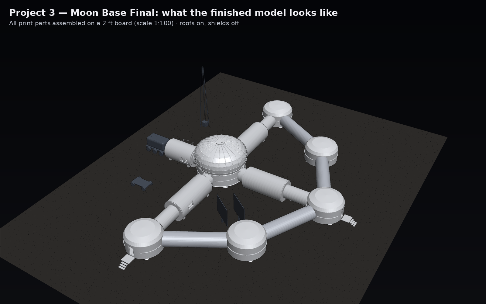

## 🎮 The two games

| | Game 1: Lunar Smart Adaptive Habitat | Game 2: Lunar Habitat Commander |
|---|---|---|
| **Play** | [▶ Play in browser](https://jaigod.github.io/ares-site/play/) | [▶ Play in browser](https://jaigod.github.io/ares-site/play2/) |
| **What it is** | The Project ARES simulator: walk the whole base in 1/6 g while an AI reads 9 sensors, scores 6 crew conditions and responds in 3 tiers | The VR adventure: command the base, talk to ARIA, mine minerals, zap aliens, build, wire power, survive solar storms and lunar night |
| **Controls** | WASD + mouse · **H** help · **F11** Project ARES deliverables | WASD + mouse · on Meta Quest with controllers |
| **Unity source** | [`Unity_Game_Moon_Base_Final/`](Unity_Game_Moon_Base_Final/) (Unity 6000.3.21f1) | Built in Unity 6 · [game info + screenshots](Docs/Lunar_Habitat_Commander/) |

## What's in this repo

| Folder | What's inside |
|---|---|
| [`play/`](play/) · [`play2/`](play2/) · [`godot/`](godot/) | The three browser builds (2 Unity WebGL + Godot web) |
| [`Godot_Crew_Health_Sim/`](Godot_Crew_Health_Sim/) | Game 3: Godot 4 crew health simulation — sleep, check-in, EVA suit HR/BP, mood detector, sensor fusion, wired habitat |
| [`Unity_Game_Moon_Base_Final/`](Unity_Game_Moon_Base_Final/) | **Lunar Smart Adaptive Habitat**: the Unity 6 source (VR + desktop). Open with Unity Hub (6000.3.21f1). |
| [`Models/`](Models/) | **Every 3D model**: all texture-baked habitat models (`Blender_Rich_Baked`), the Crew Wellness Dome, Base1 FBX, and Lunar Habitat v1 (.blend, .obj, 1:50 STL parts, renders) |
| [`Models/Health_Monitoring/`](Models/Health_Monitoring/) · [`models/health/`](models/health/) | **Health-monitoring hardware**: the Blender script and the six exported models (chest beacon, wristband, cortisol patch, zone sensor pod, Crew Health Station, sleep bunk) |
| [`3D_Print_Kits/`](3D_Print_Kits/) | All STL files for projects 1, 2 and 3 (1:150 kits + the big 1:100 2 ft board), display extras, specs spreadsheet. GitHub shows every `.stl` as a 3D model you can spin. |
| [`3D_Print_Kits/Realistic_Bases_Only/`](3D_Print_Kits/Realistic_Bases_Only/) | **One-piece STL of the realistic habitat, bases only** (no sleeping pods), ready to slice |
| [`3D_Print_Kits/BUILD_GUIDE.md`](3D_Print_Kits/BUILD_GUIDE.md) | Step-by-step print and assembly guide |
| [`Docs/Presentation_Agency_Review_Board.pdf`](Docs/Presentation_Agency_Review_Board.pdf) | **The 15-minute Agency Review Board presentation** (19 slides: game pictures, D1–D4, Config A/B, flowcharts, ethics, live-demo plan, Q1–Q6 answers) |
| [`Docs/Project_ARES_Lunar_Habitat_FINAL_slides.pdf`](Docs/Project_ARES_Lunar_Habitat_FINAL_slides.pdf) | Project ARES final slideshow |
| [`Docs/ARES_Deliverables.md`](Docs/ARES_Deliverables.md) | D1–D4 deliverables exported from the running game (sensor matrix, zones, 9-stage flowcharts, ethics) |
| [`Docs/Research_and_Proposal/`](Docs/Research_and_Proposal/) | The design proposal and the research paper (PDF) |
| [`Docs/Rubric/`](Docs/Rubric/) | Blender + Unity rubric checklists, rubric task list, 72-hour tabletop simulation report |
| [`Docs/Crew_Health_System/`](Docs/Crew_Health_System/) | The Crew Health System web dashboard ([open it](https://jaigod.github.io/ares-site/Docs/Crew_Health_System/)) |
| [`Docs/Data/`](Docs/Data/) | Habitat model data spreadsheets |
| [`Docs/Lunar_Habitat_Model_Comparison.pptx`](Docs/Lunar_Habitat_Model_Comparison.pptx) | Model comparison deck |
| [`Docs/Lunar_Habitat_Commander/`](Docs/Lunar_Habitat_Commander/) | Game 2 README, store page text and screenshots |
| [`Docs/Lunar_Habitat_Commander/Unity_Scripts/`](Docs/Lunar_Habitat_Commander/Unity_Scripts/) | **Game 2 source code**: all 84 C# scripts, organised by job, each with a header comment ([script map](Docs/Lunar_Habitat_Commander/Unity_Scripts/README.md)) |
| [`Docs/Deck_Design/`](Docs/Deck_Design/) | **Floor plan**: the first concept sketch (health zones + sizes) and the TimberTech Deck Designer build, from first octagon to the finished 3D deck |
| [`index.html`](index.html) · [`js/space3d.js`](js/space3d.js) · [`models/`](models/) | **The project website**: three.js scenes (Moon, descent to the habitat, spacewalk), web copies of the habitat and NASA astronaut models |
| [`Docs/Screenshots/`](Docs/Screenshots/) | **115 screenshots from both games** (57 realistic, 58 sci-fi) in one gallery |
| [`Docs/Chat_Log/`](Docs/Chat_Log/) | Summary of every request made while building, and where each one ended up in the games |

## 🗂️ How the code is organised

Both games use the same layout. The scripts are grouped into numbered folders by what they do, and each `.cs` file starts with a comment header covering what it does, why it exists (the request or rubric line it answers) and the credits.

| Realistic — [`Assets/Unity3/Scripts`](Unity_Game_Moon_Base_Final/Assets/Unity3/Scripts/README.md) | Sci-fi — [`Assets/HUNCH/Scripts`](Docs/Lunar_Habitat_Commander/Unity_Scripts/README.md) |
|---|---|
| `01_Core` start-up, menu, self-test | `01_Core` game rules, habitat sim, start-up |
| `02_AI_Wellness` sensors → 6 conditions → 3 tiers, human OFF switch | `02_ARES_AI` ARIA, the mood/sensor engine, D1–D6 |
| `03_Crew` 4 crew, sleep pods with mood lights, health bot | `03_Player_Controls` VR, keyboard, touch, guide arrows |
| `04_Habitat` zones, dome lights, doors, ladders, 1/6 g props | `04_UI_Menus_Audio` menus, store, music, voice |
| `05_Player_UI` VR + desktop rig, HUD, panels | `05_World_FX` Sun, storms, rockets, kid-friendly extras |
| `06_Missions` story missions + task list | `06_Frontier` A adventure · B maps & mini-games · C base & crew · D ARES layer |
| `07_Deliverables` design pages, D4 ethics, floor plan | `Editor` build and automation tools |

## 📸 Screenshots

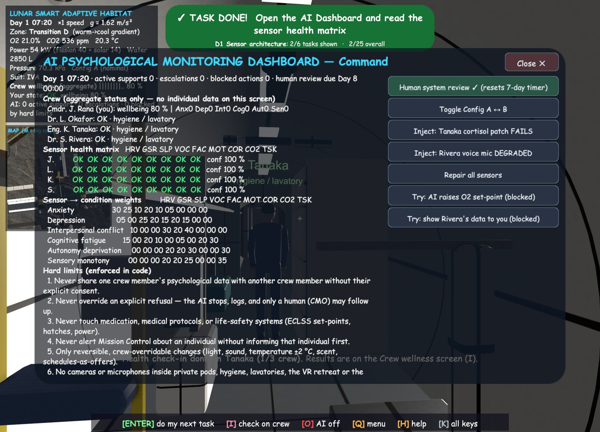 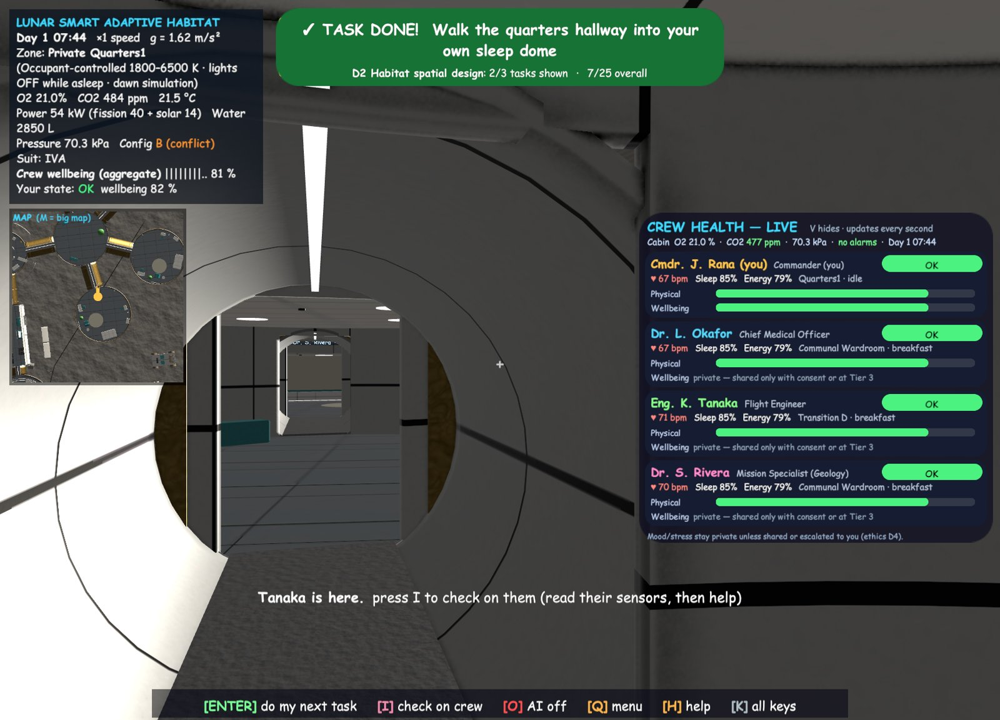 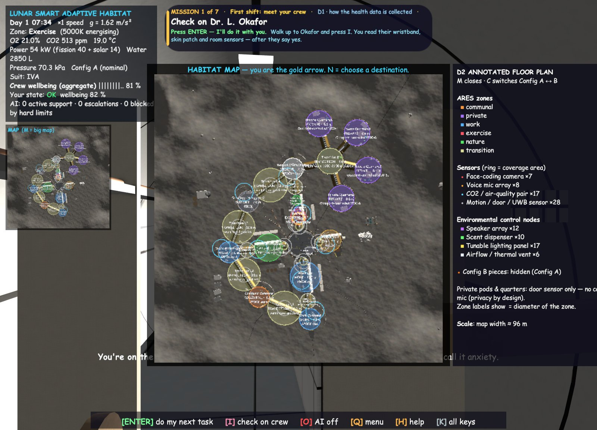
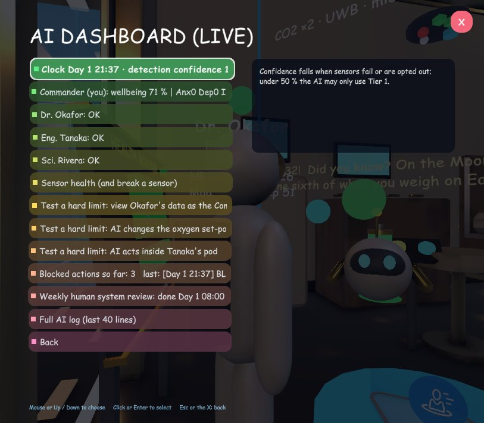 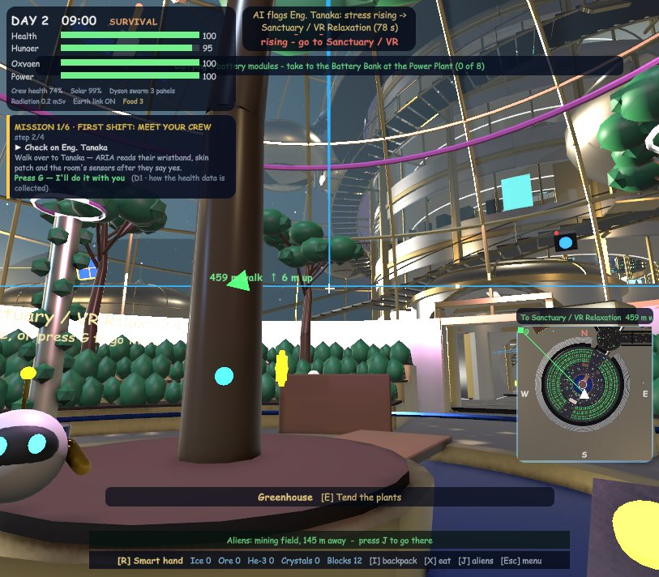 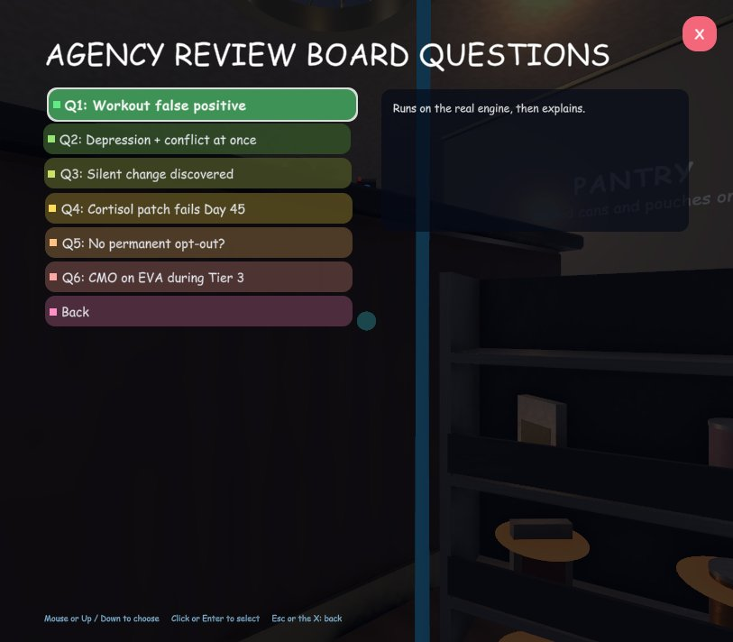

**[See all 115 screenshots →](Docs/Screenshots/README.md)**

## Presentation

[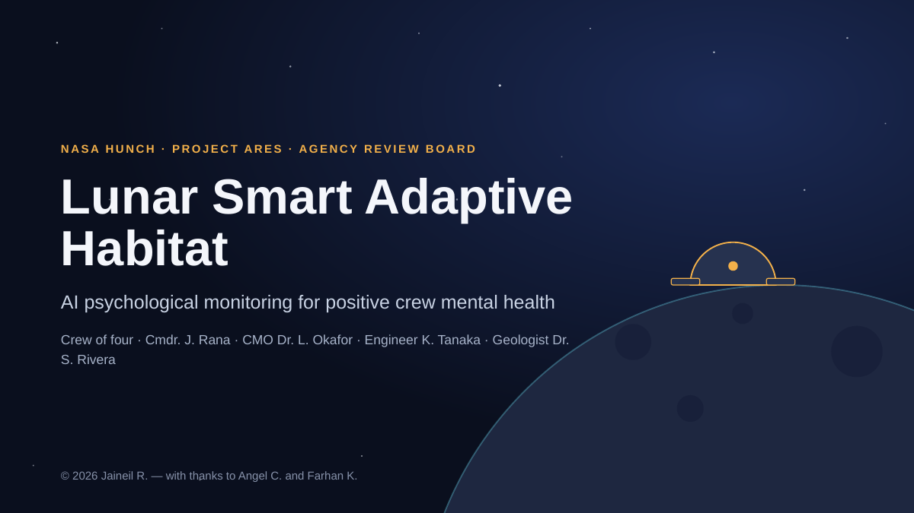](Docs/Presentation_Agency_Review_Board.pdf)

**[Review slide by slide](Docs/SLIDES.md)** (all 19 slides shown inline) · **[Open the PDF](Docs/Presentation_Agency_Review_Board.pdf)**

## Our documents, with our design typed in

Copies of our own project documents. Under each instruction we typed what we built for it and how, with screenshots from both games.

| Document | With our design |
|---|---|
| Project ARES Student Brief (self-grade on the rubric page: **200/200 + 20/20 bonus**) | [PDF](00_FINAL_FILES/1_Project_ARES_Student_Brief_with_our_design.pdf) |
| Our final slides (240/240 on the deck's scale) | [PDF](00_FINAL_FILES/2_Project_ARES_FINAL_slides_with_our_design.pdf) |
| NASA HUNCH project page | [PDF](00_FINAL_FILES/3_NASA_HUNCH_Lunar_Smart_Habitat_with_our_design.pdf) |
| Our research doc | [PDF](00_FINAL_FILES/4_Research_for_Lunar_Habitat_with_our_design.pdf) |

## Player manuals

- [Realistic game (Moon_Base_Final) — player manual](00_FINAL_FILES/5_Realistic_Game_Player_Manual.pdf)
- [Sci-fi game (Lunar Habitat Commander) — player manual](00_FINAL_FILES/6_SciFi_Game_Player_Manual.pdf)

## New design pieces (in both games, F11)

- **D1 threshold check:** the real AI engine run through 70 simulated missions — [report](Docs/Rubric/Threshold_Validation_Report.md)
- **D2 dimensioned floor plans** drawn to scale from the game models — [realistic](Docs/Diagrams/floorplan_u3.png) · [sci-fi](Docs/Diagrams/floorplan_u2.png)
- **D3 drawn flowcharts** for all six conditions — [Docs/Diagrams](Docs/Diagrams)
- **D4 written ethics report** (1,155 words) — [D4_Ethics_Report.md](Docs/D4_Ethics_Report.md)

## Project ARES rubric → where it is in the game

| Rubric | In the game |
|---|---|
| D1 Sensor architecture (35) | **F11 → D1**: 9 sensors, thresholds, 2+ failure modes each, mass/power · **F1** dashboard: break a sensor, watch graceful degradation |
| D2 Spatial design (35) | **M**: annotated floor plan with zone labels, sensor coverage rings, control nodes · **C**: Configuration A ↔ B |
| D3 AI protocols (50) | **F11 → D3**: all 9 flowchart stages for all 6 conditions · **Tab**: Tier-2 offers, STOP, overrides · **F2**: CMO Tier-3 console |
| D4 Ethics (40) | **F11 → D4**: 4 tensions, 8 hard limits enforced in code · **O**: AI off switch |
| Board Q1–Q6 | **F5**: each question set up live |
| Bonus A tabletop | **F4**: 72-hour simulation with two simultaneous events |
| Bonus B crew interface | **Tab**: own data, AI actions log, overrides, privacy, opt-out |

## Pictures

| Finished print model | Top view |
|---|---|
|  | 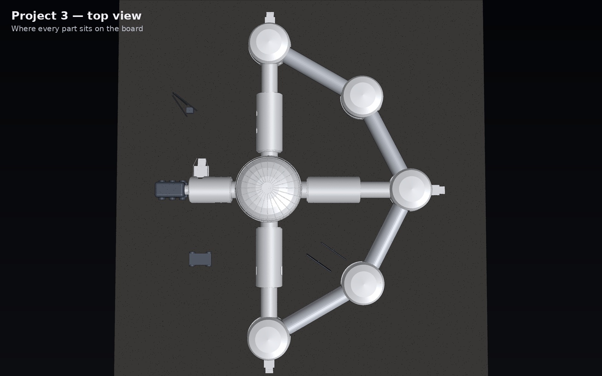 |

| With regolith shields | Real design (Blender render) |
|---|---|
| 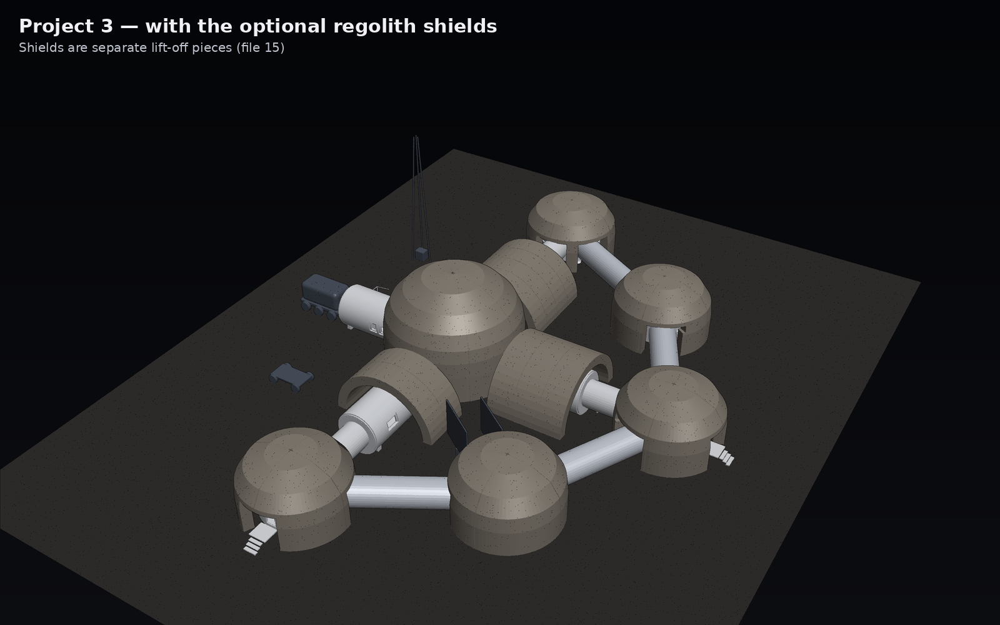 | 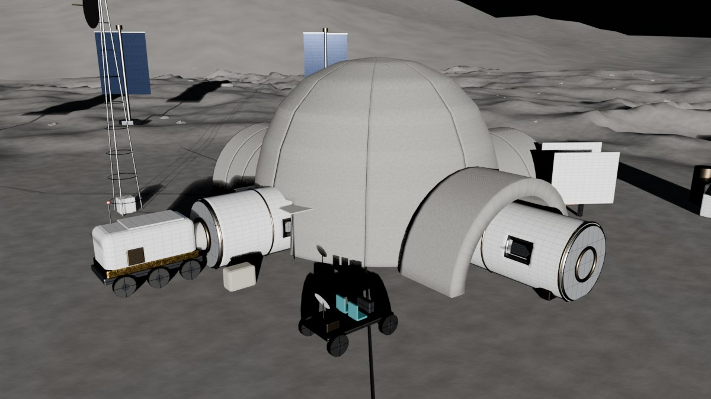 |

| Floor plan: first concept | Floor plan: finished 3D deck |
|---|---|
| 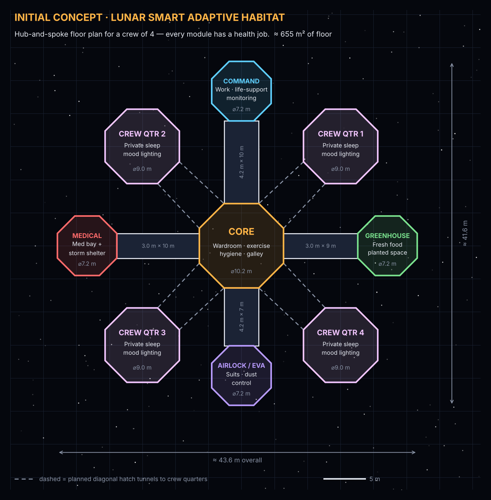 | 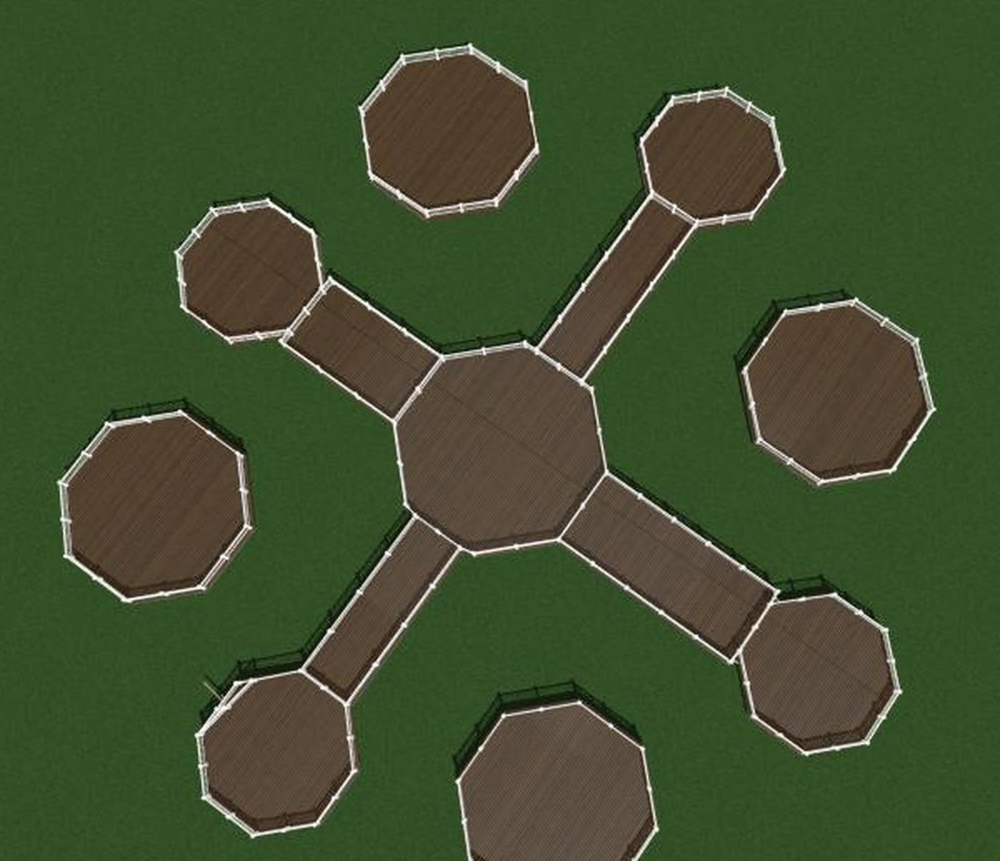 |

| Habitat exterior | Lower deck cutaway |
|---|---|
| 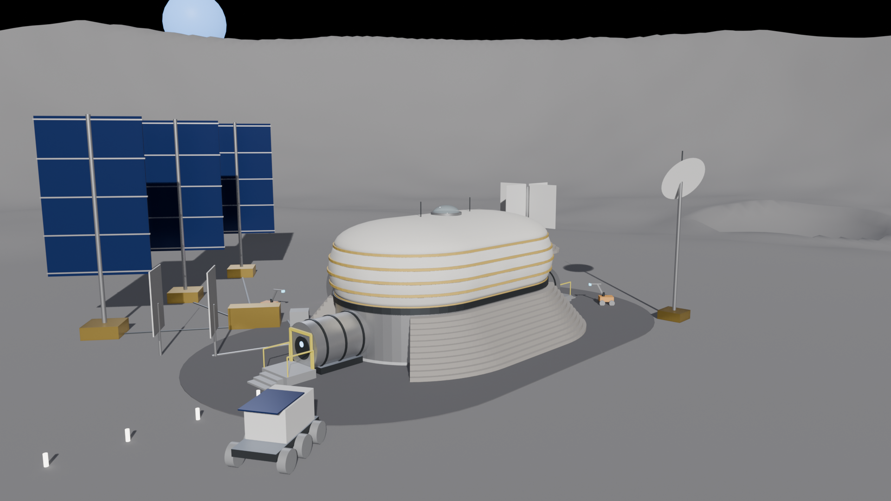 | 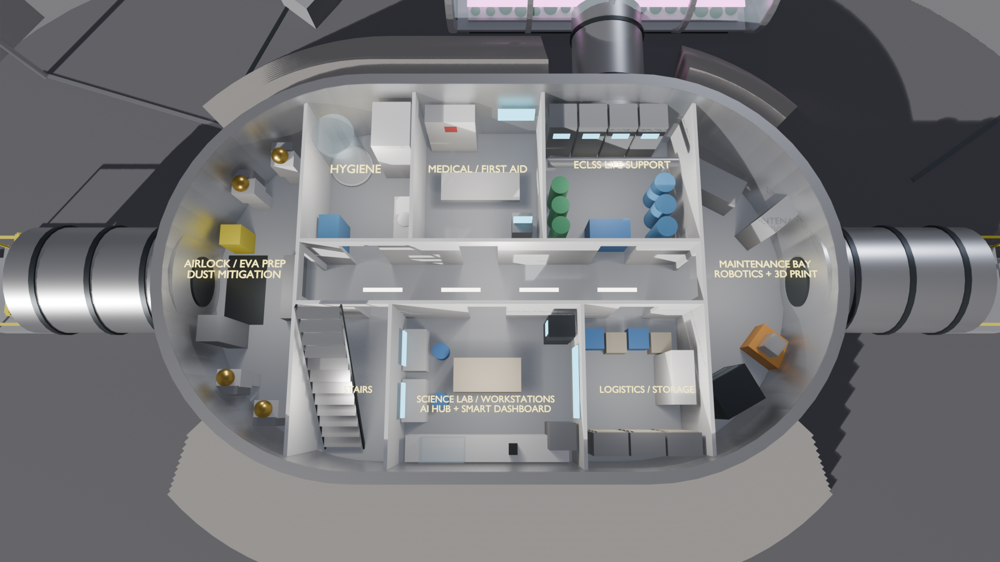 |

| Game 2: greenhouse | Game 2: mining field |
|---|---|
| 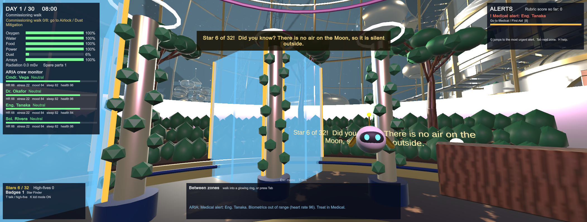 | 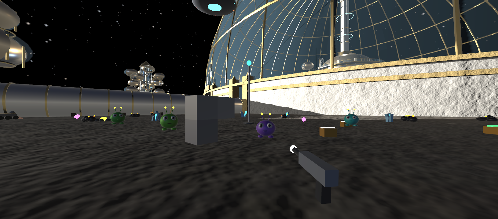 |

---
Made for NASA HUNCH, Project ARES · **© 2026 Jaineil R.** · with thanks to Angel C. and Farhan K.
